# Segmentação da área de atuação entre drones, colaboração e detecção de pessoas (Objetivo 5 – Atividade 13)

**Repositório:** `cerise-2026-drones-segmentacao` (GitHub, organização do CERISE)
**Espelho local:** `E:\CERISE\FRENTES\NAVEGACAO AUTONOMA\DRONES_SEGMENTACAO`
**Execução da detecção:** DGX Spark (NVIDIA GB10), `~/cerise2026/drones`, contêiner `cerise26_drones:latest`

## 1. Objetivo

Esta seção documenta a execução da Atividade 13 do Objetivo 5 do Plano de Trabalho (software funcional de
segmentação da área de atuação entre os drones disponíveis), do item 1 desse objetivo (planejamento e
adequação de um projeto com drones para detecção e contagem de pessoas) e dos algoritmos de colaboração
entre drones citados no Objetivo 2. O plano de 2025 previa uma rede de dois ou mais drones capaz de
identificar pessoas, casas, carros e árvores; em 2026 o foco foi tornar operacional a divisão de uma área
entre uma frota heterogênea, gerar missões executáveis por drone, tratar a perda de um drone durante a
missão e validar o pipeline de detecção e contagem de pessoas em imagens aéreas.

## 2. Metodologia

### 2.1 Modelo do problema

A entrada é o polígono da área de atuação em GeoJSON (lon/lat), zonas proibidas opcionais (também em
GeoJSON, com margem de segurança configurável, 10 m nos experimentos) e a frota. Cada drone é descrito por
velocidade de cruzeiro, autonomia, reserva de bateria (20 %), campo de visão horizontal e vertical da
câmera, altitude de voo e base de decolagem. Todo o planejamento é feito em coordenadas métricas UTM
(zona escolhida automaticamente pelo centroide; para Goiânia, WGS 84 / UTM 22S, EPSG:32722) e as saídas
voltam para lon/lat.

A pegada da câmera em nádir sobre terreno plano tem largura `L = 2h·tan(HFOV/2)` e comprimento
`C = 2h·tan(VFOV/2)`. O espaçamento entre linhas de varredura é `s = L·(1 − sobreposição lateral)` (20 %
nos experimentos) e a distância entre disparos é `C·(1 − sobreposição frontal)` (70 %). A taxa de
cobertura do drone é `v·s` (m²/s). Foram definidos três tipos de drone, com parâmetros representativos de
multirrotores de pequeno porte (não correspondem a um modelo comercial específico), todos a 40 m de altura:

| Tipo | Velocidade | Autonomia | HFOV × VFOV | Pegada (m) | Espaçamento (m) | Taxa (m²/s) |
|---|---|---|---|---|---|---|
| A – quadricóptero médio | 10 m/s | 20 min | 70° × 55° | 56,0 × 41,6 | 44,8 | 448 |
| B – lento, bateria maior | 6 m/s | 30 min | 70° × 55° | 56,0 × 41,6 | 44,8 | 269 |
| C – rápido, grande-angular | 14 m/s | 25 min | 82° × 52° | 69,5 × 39,0 | 55,6 | 778 |

A frota homogênea usa apenas o tipo A; a heterogênea alterna A, B, C, A, B, C. Com uma câmera 4K
(3840 px na horizontal), 56 m de pegada a 40 m de altura correspondem a cerca de 1,5 cm/pixel, escala
compatível com a das imagens do VisDrone usadas na detecção.

### 2.2 Métodos de partição comparados

1. **Faixas ponderadas** – a área é cortada em faixas paralelas à direção ótima de varredura, com posições
   de corte obtidas por bisseção para que a área de cada faixa seja proporcional ao peso do drone. Os
   drones são ordenados pela projeção da base na normal à direção de varredura.
2. **k-means + Voronoi** – k-means sobre ~4000 pontos amostrados na área livre; as células de Voronoi dos
   centroides são recortadas pelo polígono e atribuídas aos drones pelo método Húngaro (distância da base ao
   centroide). É a linha de base clássica, **não ponderada**.
3. **DARP em grade** (inspirado em Kapoutsis et al., 2017) – grade de células quadradas de 1/3 do menor
   espaçamento, alinhada à direção ótima de varredura; cada célula é atribuída ao drone que minimiza a
   distância geodésica na grade a partir da sua semente, com balanceamento iterativo até que a área de cada
   drone esteja a menos de 1 % do alvo (peso × área) e todas as regiões sejam conexas. Foram implementadas a
   pesagem multiplicativa original (`E_i = m_i·C_i·D_i`, com matriz de correção de conectividade) e uma
   pesagem aditiva (`E_i = D_i − b_i`), cujas regiões são estreladas em torno da semente na métrica
   geodésica e, portanto, conexas por construção. Depois da convergência, as fronteiras em escada são
   retificadas (simplificação Douglas–Peucker das arestas internas, repoligonização e reatribuição de cada
   face, sem perder a propriedade de partição) e fragmentos menores que (s/2)² são entregues à região vizinha.
4. **DARP + refinamento por tempo** (proposta deste trabalho) – sementes nos centros de um k-means
   ponderado, pesos iniciais proporcionais à taxa de cobertura `v·s` e quatro iterações de reajuste
   `w_i ← w_i·(T̄/T_i)^0,8`, onde `T_i` é o tempo de missão estimado do drone (trânsito desde a base,
   curvas, subida, descida e trocas de bateria). Mantém-se a solução de menor makespan.

Os pesos podem ser `taxa` (v·s, iguala o tempo de varredura), `capacidade` (v·s·autonomia útil, iguala o
uso de bateria) ou `igual`.

### 2.3 Planejamento de cobertura por subárea

Cada subárea recebe uma rota boustrophedon. Para cada direção candidata (arestas mais longas do fecho
convexo, arestas do retângulo mínimo, a direção global da partição e uma grade de 15°), a região é girada,
dividida em faixas de altura `s' ≤ s` igualmente espaçadas e cada faixa é voada na extensão em x do trecho
da região que ela contém, descontada meia pegada longitudinal (assim bordas inclinadas não deixam
lacunas). Trechos de uma mesma faixa em regiões côncavas formam células monótonas visitadas de forma
gulosa. Trechos que cruzariam zonas proibidas são divididos e as ligações de trânsito usam o menor caminho
num grafo de visibilidade em torno das zonas com margem. Escolhe-se a direção de menor tempo estimado:
`T = subida + distância/v + n_curvas·4 s + descida`.

A checagem de bateria percorre a rota em passos de 25 m. Antes de cada passo verifica se, depois dele,
ainda há autonomia útil para voltar à base e pousar. Se não houver, o drone volta, troca a bateria
(5 min), decola e retoma do ponto onde parou. O tempo de missão inclui essas trocas.

### 2.4 Métricas

São medidos: o **makespan** (maior tempo de missão da frota); o **coeficiente de variação (CV)** dos
tempos de missão como medida de balanceamento; a distância total; o número de curvas (mudanças de rumo
acima de 20°); a **cobertura rasterizada**, isto é, a fração das ~200 mil células (passo de 1 a 1,5 m) da
área livre cobertas por pelo menos uma pegada; a sobreposição entre drones (células cobertas por dois ou
mais drones); o número de voos (baterias); e o tempo de execução da partição mais o planejamento.

### 2.5 Cenários

- **UFG – Campus Samambaia (real):** polígono do campo aberto (`landuse=meadow`, OpenStreetMap way
  362871566, © contribuidores do OpenStreetMap, licença ODbL) no setor oeste do campus, a oeste da
  Alameda Flamboyant e ao norte da mata do campus. Centroide em −16,6038° S, −49,2723° O. Área de
  34,23 ha, polígono côncavo com 49 vértices após simplificação de 3·10⁻⁵ graus; o arquivo é
  `dados/ufg_samambaia_campo_aberto.geojson`.
- **Sintético convexo** (96 ha), **côncavo em L com uma zona proibida circular de 45 m de raio** (43 ha) e
  **côncavo em U com duas zonas proibidas** (50 ha). Os três foram ancorados perto de Goiânia para que as
  exportações geográficas sejam válidas.
- N = 2 a 6 drones, frotas homogênea e heterogênea, bases distribuídas no contorno e recuadas 15 m para
  fora. São 160 execuções no benchmark principal e 70 na ablação.

## 3. Implementação

O pacote Python `cerise_drones` tem os módulos `geo`, `frota`, `particao`, `cobertura`, `metricas`,
`exportar`, `visualizar`, `colaboracao`, `protocolo` e `agregacao`. Usa shapely 2.2, pyproj 3.7,
scikit-learn 1.9, scipy, matplotlib 3.11 e folium 0.20, com captura de tela via Playwright/Chromium. Por
drone, ele exporta:

- **QGroundControl `.plan`** (fileType Plan v1, firmware PX4): `MAV_CMD_NAV_TAKEOFF` (22),
  `MAV_CMD_DO_CHANGE_SPEED` (178), waypoints `MAV_CMD_NAV_WAYPOINT` (16) em `MAV_FRAME_GLOBAL_RELATIVE_ALT`,
  `MAV_CMD_DO_SET_CAM_TRIGG_DIST` (206), que liga o disparo por distância no início de cada trecho de
  cobertura e o desliga no fim, e `MAV_CMD_NAV_RETURN_TO_LAUNCH` (20). A geocerca inclui a área (inclusão,
  margem de 30 m) e as zonas proibidas (exclusão). Os planos passam por um validador estrutural do formato
  do QGC; a abertura no próprio QGroundControl não foi feita nesta etapa.
- **KML** (rota com `relativeToGround`, subárea e base) e **GeoJSON** (subárea, rota e waypoints).
- Figura PNG (matplotlib) e mapa interativo folium com imagem de satélite, capturado com Playwright.

A suíte de 16 testes (`tests/`) passou integralmente (Figura 10). Ela verifica que as subáreas são
disjuntas e cobrem a área livre em todos os métodos, o balanceamento do DARP, cobertura acima de 99 % sem
atravessar zonas proibidas, a inserção de trocas de bateria, a validade dos `.plan`, a compatibilidade
byte a byte com o protocolo LoRa da frente LoRa e o georreferenciamento.

## 4. Resultados

### 4.1 Campus Samambaia com 4 drones heterogêneos

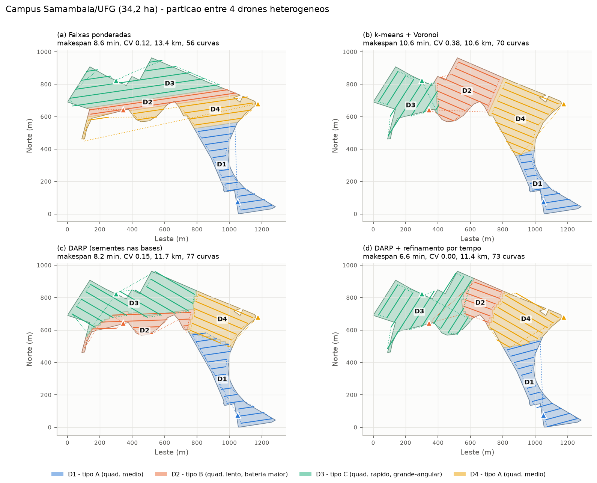

| Método | Makespan (min) | CV do tempo | Distância total (km) | Curvas | Cobertura (%) |
|---|---|---|---|---|---|
| Faixas ponderadas | 8,63 | 0,120 | 13,36 | 56 | 100,00 |
| k-means + Voronoi | 10,63 | 0,385 | 10,65 | 70 | 100,00 |
| DARP (sementes nas bases) | 8,18 | 0,152 | 11,66 | 77 | 100,00 |
| **DARP + refinamento** | **6,57** | **0,002** | 11,37 | 73 | 100,00 |

No plano final (DARP + refinamento), o drone rápido C (D3) recebeu 13,46 ha, os do tipo A receberam
7,07 ha e 9,20 ha e o lento B, 4,50 ha. Os quatro terminam entre 6,54 e 6,57 min, usando 22 % a 33 % da
bateria. A sobreposição entre drones foi de 7,0 % das células. Os quatro `.plan`, os KML e os GeoJSON estão
em `resultados/missao_ufg/`.

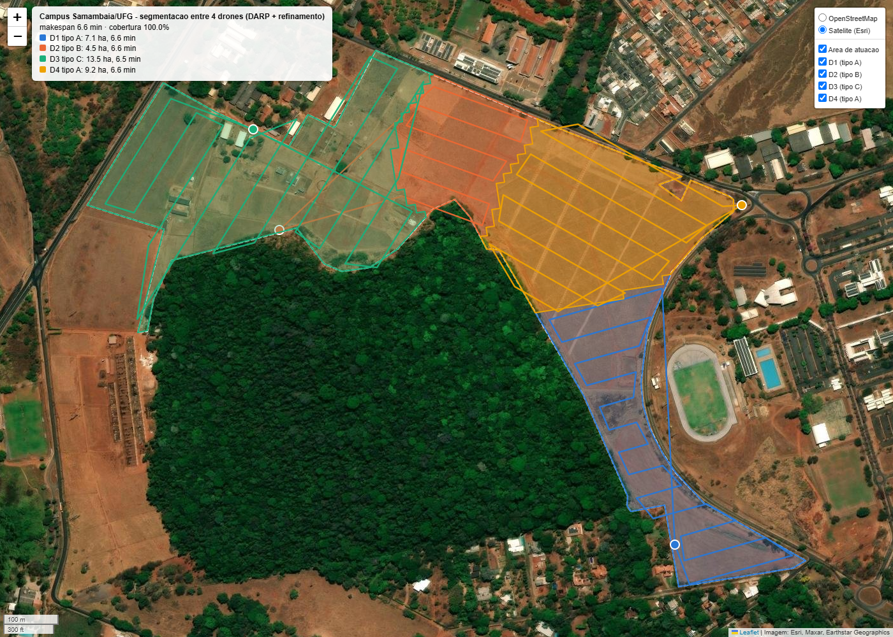

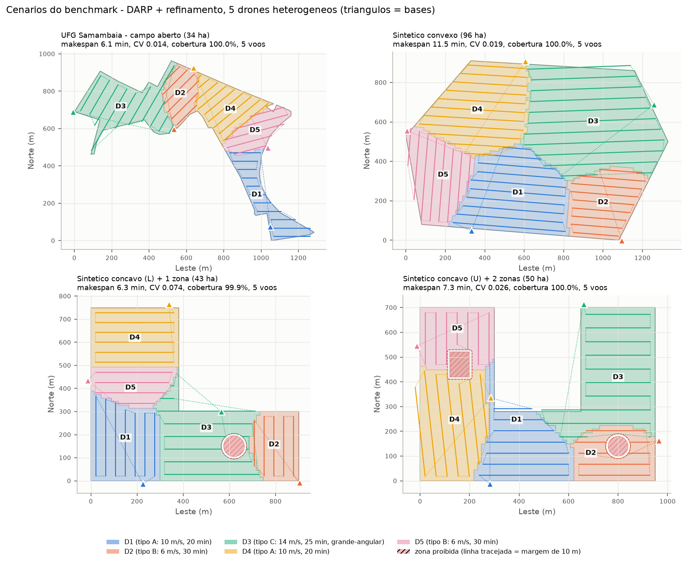

### 4.2 Benchmark (4 cenários × N = 2..6 × 2 frotas)

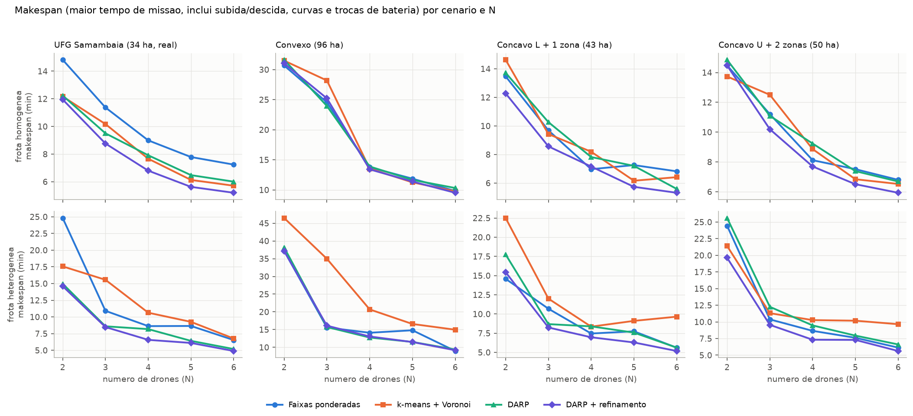

Médias sobre os 4 cenários e N = 2..6 (20 casos por linha; `resultados/benchmark_resumo.csv`):

| Frota | Método | Makespan médio (min) | Makespan / melhor do caso | CV do tempo | Distância (km) | Curvas | Cobertura (%) | Sobrep. entre drones (%) | Voos | Tempo alg. mediano (s) | Vitórias |
|---|---|---|---|---|---|---|---|---|---|---|---|
| homogênea | faixas | 11,66 | 1,153 | 0,097 | 17,66 | 50,5 | 99,99 | 7,5 | 4,20 | 0,45 | 2 |
| homogênea | k-means | 11,47 | 1,100 | 0,117 | 16,06 | 74,2 | 99,99 | 3,9 | 4,15 | 0,58 | 2 |
| homogênea | DARP | 11,37 | 1,107 | 0,055 | 16,96 | 78,0 | 99,98 | 9,1 | 4,25 | 1,17 | 1 |
| homogênea | **DARP + ref.** | **10,64** | **1,008** | **0,023** | 16,30 | 74,2 | 99,98 | 6,2 | 4,25 | 5,78 | **15** |
| heterogênea | faixas | 12,68 | 1,189 | 0,123 | 16,63 | 48,7 | 99,96 | 8,1 | 4,20 | 0,39 | 3 |
| heterogênea | k-means | 15,90 | 1,504 | 0,308 | 15,46 | 72,0 | 99,99 | 4,0 | 4,15 | 1,06 | 0 |
| heterogênea | DARP | 12,04 | 1,119 | 0,075 | 16,30 | 73,0 | 99,98 | 10,4 | 4,15 | 1,03 | 1 |
| heterogênea | **DARP + ref.** | **10,96** | **1,007** | **0,028** | 15,74 | 70,7 | 99,97 | 7,5 | 4,10 | 7,12 | **16** |

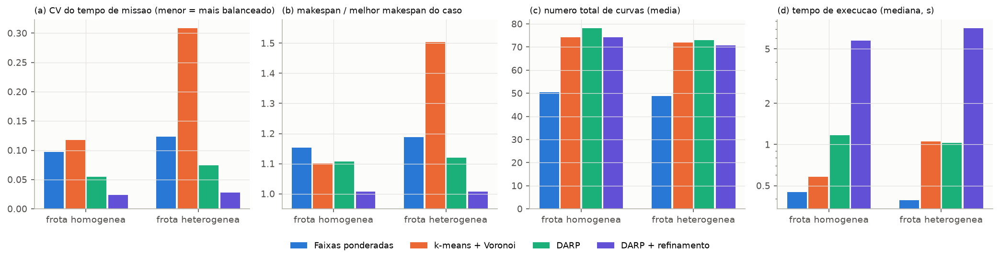

Principais observações:

- O DARP com refinamento por tempo teve o menor makespan em 31 dos 40 casos. Em média ficou a 0,7–0,8 %
  do melhor resultado de cada caso e reduziu o CV dos tempos de missão para 0,023–0,028, contra 0,097–0,308
  dos demais métodos.
- Com frota heterogênea, o k-means/Voronoi, que não é ponderado, teve makespan 50 % acima do melhor em
  média (CV 0,31), o que mostra a necessidade de ponderar pela capacidade. As faixas ponderadas fazem menos
  curvas (48–51 contra 70–78), mas pagam em trânsito e em faixas fragmentadas nos polígonos côncavos.
- A cobertura rasterizada ficou entre 99,65 % e 100 % em todas as 160 execuções. A checagem de bateria
  entrou em ação no cenário convexo de 96 ha com N = 2–3 (até 6 voos para 3 drones) e, com 2 drones
  heterogêneos, no UFG (faixas) e no U côncavo (faixas e DARP).
- Tempos de execução: medianas de 0,4 a 1,2 s para os métodos de passo único e de 5,8 a 7,1 s para o DARP +
  refinamento, que executa cinco partições e planejamentos completos. As medições foram feitas num
  notebook compartilhado com outras tarefas, então os máximos (até 30 s) incluem interferência externa.

**Ablação** (UFG e U côncavo, frota heterogênea, N = 2..6; `resultados/ablacao_resumo.csv`): a pesagem
multiplicativa original não convergiu no polígono real da UFG (erro máximo de área de 24,9 % em relação ao
alvo, contra 0,6–1,2 % da aditiva). Sementes em centros de k-means reduziram o makespan em relação a
sementes nas bases (8,61 contra 8,67 min no UFG; 11,44 contra 12,38 min no U). Pesos iguais pioraram o
makespan (11,19 min no UFG). Pesos por capacidade, que igualam o uso de bateria, ficaram entre os dois
(9,23 min no UFG). O refinamento por tempo foi o fator de maior ganho: 8,13 min no UFG e 9,89 min no U, com
CV de 0,011 e 0,041.

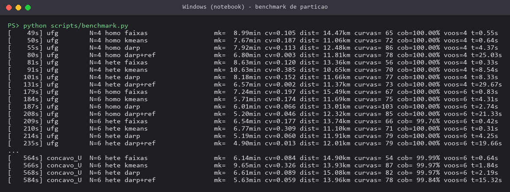

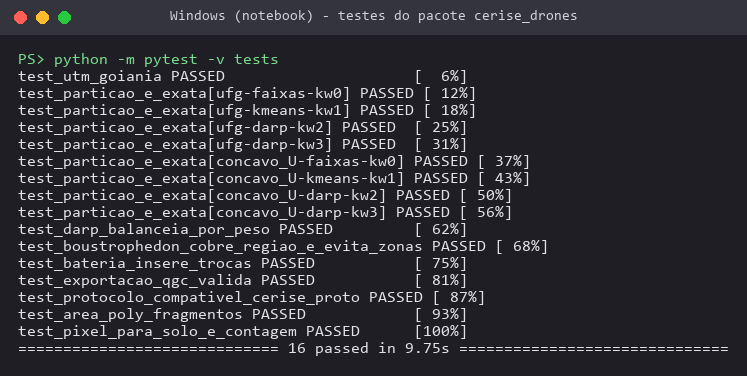

### 4.3 Colaboração: falha ou bateria baixa no meio da missão

Foi simulado o abandono da missão por um drone (falha ou retorno por bateria baixa) no plano da UFG com 4
drones heterogêneos (makespan sem falha: 394 s). A falha é detectada pela ausência de HEARTBEAT, com 3 s
de atraso. As três estratégias comparadas foram:

- **sem realocação** – a parte não varrida da subárea é perdida;
- **repartição** – a área ainda não coberta por nenhum drone é repartida entre os sobreviventes a partir
  das posições atuais. Cada componente conexa recebe um subconjunto de drones, por enumeração das alocações,
  e passa por DARP com refinamento pelo instante de conclusão, considerando a bateria já consumida. A
  difusão é feita por AREA_ASSIGN e AREA_POLY;
- **leilão** – a área órfã é dividida em tarefas (células de 2s × 2s) e distribuída por leilão sequencial
  de item único com objetivo minimax (TASK_BID e TASK_AWARD). As tarefas ganhas são varridas depois da
  própria subárea.

Foram simuladas 12 falhas (cada drone, a 25 %, 50 % e 75 % do seu voo); `resultados/colaboracao.csv`:

| Instante da falha | Sem realocação: área perdida (%) | Repartição: aumento do makespan (%) | Leilão: aumento do makespan (%) | Quadros LoRa (repartição / leilão) | Tempo no ar SF9 (s) (rep. / leilão) |
|---|---|---|---|---|---|
| 25 % do voo | 16,7 | +33,3 | +49,2 | 20,0 / 59,8 | 5,5 / 10,5 |
| 50 % do voo | 9,5 | +18,3 | +32,2 | 15,0 / 38,5 | 4,0 / 6,8 |
| 75 % do voo | 1,4 | +17,8 | +12,2 | 8,0 / 12,8 | 2,0 / 2,3 |
| média (12 casos) | 9,2 (máx. 26,4) | +23,1 | +31,2 | 14,3 / 37,0 | 3,8 / 6,5 |

Sem realocação, o makespan não muda, mas em média 9,2 % da área fica descoberta (até 26,4 % quando o drone
rápido C falha a 25 %). As duas estratégias colaborativas recuperam ≥ 99,7 % de cobertura (as lascas menores que (s/2)² descartadas na limpeza da área não coberta explicam o restante). A repartição
foi melhor em 9 dos 12 casos. O leilão foi melhor quando a falha ocorre tarde (75 %), porque a área órfã é
pequena e os sobreviventes não abandonam as próprias rotas. Uma política híbrida, que escolhe o menor dos
dois, teria aumento médio de makespan de 20,6 %. O replanejamento levou em média 1,95 s (repartição) e
0,08 s (leilão).

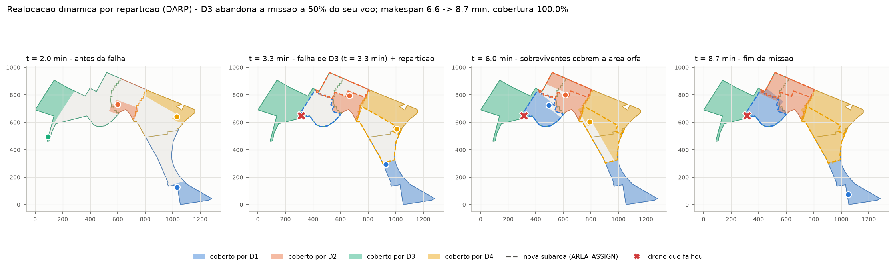

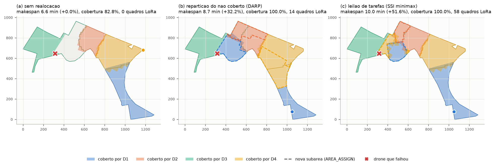

A animação da mesma simulação está em `evidencias/colaboracao_reparticao.gif`.

### 4.4 Mensagens LoRa

O conjunto de mensagens foi alinhado com a biblioteca `cerise_proto` v1 já implementada pela frente LoRa
(`NAVEGACAO AUTONOMA/LORA/firmware/lib/cerise_proto`). O módulo `cerise_drones.protocolo` codifica e
decodifica os mesmos quadros byte a byte: cabeçalho de 8 B (versão/tipo, flags, net_id, origem, destino,
seq u16, len), payload de até 32 B e CRC-16/CCITT-FALSE. Os testes conferem o valor de verificação 0x29B1
e os tamanhos de quadro da tabela de tempo no ar da frente LoRa. O AREA_ASSIGN v1 descreve apenas um
retângulo envolvente, insuficiente para as subáreas poligonais do DARP; por isso foi proposta uma extensão
(tipos 7–9) a ser incorporada pela frente LoRa:

| Mensagem | Quadro (B) | SF7 (ms) | SF9 (ms) | SF10 (ms) | Origem |
|---|---|---|---|---|---|
| HEARTBEAT | 18 | 51,5 | 185,3 | 329,7 | cerise_proto v1 |
| POS | 24 | 61,7 | 205,8 | 370,7 | cerise_proto v1 |
| AREA_ASSIGN (retângulo, altitude, espaçamento) | 32 | 71,9 | 246,8 | 452,6 | cerise_proto v1 |
| COVERAGE_DONE | 17 | 51,5 | 164,9 | 329,7 | cerise_proto v1 |
| COUNT_REPORT | 23 | 61,7 | 205,8 | 370,7 | cerise_proto v1 |
| ACK | 16 | 51,5 | 164,9 | 329,7 | cerise_proto v1 |
| AREA_POLY (até 7 vértices, fragmentado) | 42 | 87,3 | 287,7 | 534,5 | extensão proposta |
| TASK_BID | 14 | 46,3 | 164,9 | 288,8 | extensão proposta |
| TASK_AWARD | 13 | 46,3 | 164,9 | 288,8 | extensão proposta |

No AREA_POLY, os vértices são deslocamentos inteiros em metros (int16) a partir do canto do retângulo do
AREA_ASSIGN, e o polígono é simplificado com tolerância de 2 m. Em SF9, que é o padrão do firmware da
frente LoRa, todos os quadros ficam abaixo do limite de ocupação de 400 ms. Em SF10, AREA_ASSIGN e
AREA_POLY o ultrapassam. Na média, uma repartição custou 14 quadros (537 B, 3,8 s no ar em SF9, sem
contar ACKs) e um leilão, 37 quadros (608 B, 6,5 s no ar).

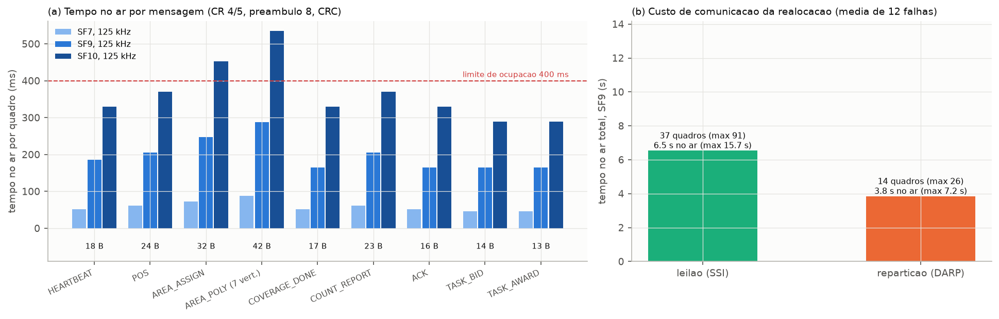

### 4.5 Detecção e contagem de pessoas (validação do pipeline)

**Dados:** VisDrone2019-DET, obtido pelos zips oficiais referenciados no `VisDrone.yaml` do ultralytics
(GitHub `ultralytics/assets`). As categorias *pedestrian* e *people* foram unidas na classe *pessoa*. O
subconjunto tem treino com 6471 imagens e 106 396 pessoas, val com 548 imagens e 13 969 pessoas e test-dev
com 1610 imagens e 27 382 pessoas. As imagens de treino foram reduzidas para 960 px no lado maior, e
val/test-dev ficaram na resolução original.

**Ambiente:** contêiner `cerise26_drones` (`FROM nvcr.io/nvidia/pytorch:26.05-py3`, PyTorch 2.12 NGC,
ultralytics 8.4.189 instalado sem substituir o torch da NVIDIA), no DGX Spark (GB10, aarch64). O teto de
memória de GPU de 7,5 GB foi imposto por `set_per_process_memory_fraction` e o pico medido foi de 6,5 GB.
No GB10, o autocast FP16 produziu NaN e caixas espúrias com confiança ≈ 1 (diagnóstico em
`deteccao/teste_amp.py`), por isso treino e inferência foram feitos em FP32.

**Fine-tuning:** YOLO11s com pesos COCO, imgsz 960, lote 4, AdamW (lr 0,002), limite de 0,8 h. Foram 5
épocas em 48,7 min de treino (49,0 min com a validação final); a quinta foi encerrada pelo limite de tempo. A GPU estava compartilhada com outros
jobs durante o treino.

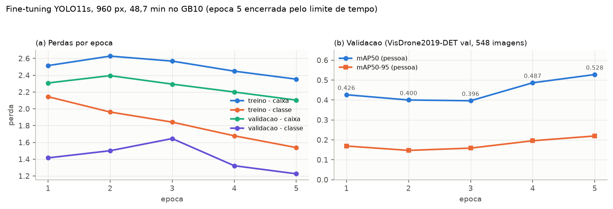

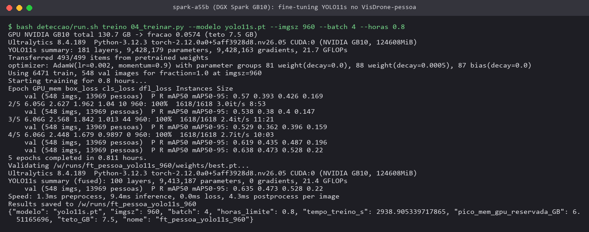

**mAP da classe pessoa** (validador do ultralytics, FP32, conf 0,001, IoU 0,7):

| Modelo | imgsz | Split | mAP50 | mAP50-95 | P | R |
|---|---|---|---|---|---|---|
| YOLO11n COCO | 640 | val | 0,160 | 0,057 | 0,438 | 0,181 |
| YOLO11n COCO | 960 | val | 0,274 | 0,111 | 0,488 | 0,285 |
| YOLO11s COCO | 640 | val | 0,249 | 0,096 | 0,484 | 0,269 |
| YOLO11s COCO | 960 | val | 0,384* | 0,163* | 0,567 | 0,363 |
| YOLO11m COCO | 640 | val | 0,307 | 0,126 | 0,575 | 0,300 |
| YOLO11m COCO | 960 | val | 0,433 | 0,194 | 0,632 | 0,401 |
| YOLO11s COCO | 1280 | val | 0,443 | 0,201 | 0,612 | 0,417 |
| **YOLO11s ajustado** | 960 | val | **0,528** | **0,220** | 0,638 | 0,473 |
| YOLO11s COCO | 960 | test-dev | 0,183 | 0,077 | 0,447 | 0,192 |
| **YOLO11s ajustado** | 960 | test-dev | **0,316** | **0,121** | 0,506 | 0,312 |

\* Com `max_det=1000`, igual ao do modelo ajustado; com o padrão `max_det=300`, o valor é 0,372/0,159. As
linhas dos modelos COCO, exceto as marcadas, usam `max_det=300`.

O fine-tuning curto elevou o mAP50 de pessoa do YOLO11s a 960 px de 0,384 para 0,528 no val (+37 %) e de
0,183 para 0,316 no test-dev (+73 %), superando inclusive o YOLO11m COCO a 960 px e o YOLO11s COCO a
1280 px.

**Erro de contagem por imagem.** Considera-se contagem a soma das detecções com confiança ≥ limiar. O
limiar foi escolhido no val (mínimo MAE) e aplicado ao test-dev. Detecções com centro nas regiões
ignoradas do VisDrone (multidões e áreas não anotadas, categoria 0) foram descartadas, como no protocolo
oficial do VisDrone.

| Modelo | Limiar (val) | MAE val | MAPE val | Erro total val | MAE test-dev | MAPE test-dev | Erro total test-dev |
|---|---|---|---|---|---|---|---|
| YOLO11s COCO | 0,05 | 9,91 | 44,8 % | −26,3 % | 11,44 | 81,7 % | −54,4 % |
| **YOLO11s ajustado** | 0,175 | **6,91** | **31,3 %** | −13,8 % | **8,76** | **61,2 %** | −42,8 % |

Para o modelo COCO, o mínimo ficou no limite inferior da grade de limiares (0,05). O MAPE foi calculado só
sobre as imagens com pelo menos uma pessoa. O viés é de subcontagem nos dois conjuntos e mais forte no
test-dev, que concentra pessoas muito pequenas e imagens noturnas.

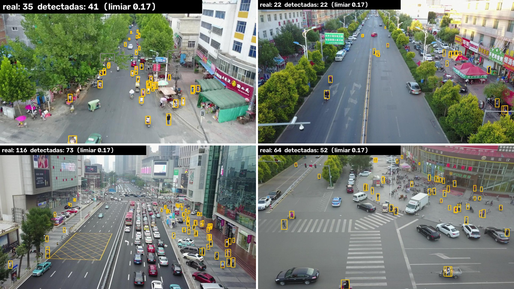

**Desempenho no GB10** (lote 1, FP32, 150 imagens pré-carregadas, GPU e CPU compartilhadas com outros
jobs): o YOLO11s ajustado chegou a 25,5 FPS de ponta a ponta a 960 px (39,2 ms/imagem, sendo 18,2 ms de
inferência) e a 31,0 FPS a 640 px. Para comparação, o YOLO11n atingiu 28,8 FPS a 960 px e o YOLO11m,
12,9 FPS. O pós-processamento (NMS, ~17 ms) dominou devido à carga da CPU no momento. A taxa de disparo
das câmeras no plano (uma foto a cada 12,5 m a 10 m/s, isto é, 0,8 foto/s por drone) fica duas ordens de
grandeza abaixo dessa vazão, o que permite processar as imagens de vários drones numa única estação.

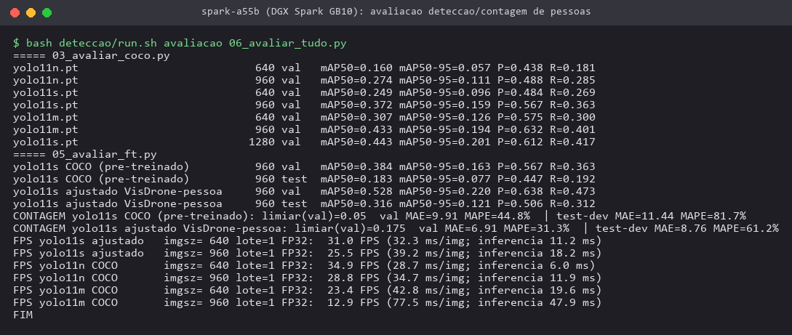

### 4.6 Agregação das contagens entre drones

Como as subáreas da partição são disjuntas, a contagem total é a soma das contagens de cada subárea, desde
que cada detecção seja contada uma única vez. O método implementado (`cerise_drones.agregacao`) segue
quatro passos:

1. Cada detecção (u, v) é **georreferenciada** pela posição, altitude e rumo do drone no instante da foto
   (câmera em nádir, terreno plano).
2. **Posse:** a detecção só é contada pelo drone dono da subárea onde o ponto cai. Pessoas vistas pela
   pegada que extravasa para a subárea vizinha ficam com o vizinho.
3. **Deduplicação:** como fotos consecutivas se sobrepõem (70 % de sobreposição frontal e 20 % lateral), a
   mesma pessoa aparece em várias fotos. Detecções a menos de um raio `r` são agrupadas por ligação simples
   e contadas uma vez.
4. Numa **faixa de fronteira** de largura `max(3 m, 2r)`, o agrupamento é feito entre drones, que trocam
   as posições das detecções de borda via COUNT_REPORT. Isso absorve o erro de georreferenciamento e a
   sobreposição das pegadas.

A lógica foi validada por simulação, com pessoas sintéticas: 300 distribuídas uniformemente mais 6 grupos
de 8 pessoas sobre as fronteiras, todas estáticas, no plano da UFG com 619 fotos. A simulação usa ruído de
georreferenciamento σ por detecção e por foto; os resultados estão em `resultados/agregacao_*.json`.

| Detector | σ (m) | raio r (m) | Soma ingênua | Dedup. sem posse | Proposto (posse + dedup. + borda) |
|---|---|---|---|---|---|
| ideal (R = P = 1) | 0,8 | 3,0 | +300,5 % | +6,8 % ± 3,4 | **−1,1 % ± 1,8** |
| ideal | 0,8 | 2,0 | +300,5 % | +55,6 % | +42,8 % |
| ideal | 0,3 | 2,0 | +300,5 % | +4,0 % | −6,8 % |
| ideal | 0,3 | 1,0 | +300,5 % | +32,3 % | +17,0 % |
| R = 0,473 medido, P = 1 | 0,8 | 2,0 | +87,2 % | +17,6 % | +10,2 % |
| R = 0,473, P = 0,638 medidos, FP aleatórios | 0,8 | 2,0 | +196,5 % | +120,7 % | +102,7 % |

A soma ingênua das detecções por foto superestima a contagem em cerca de 4 vezes por causa da
sobreposição entre fotos. A regra de posse reduziu o erro em 8 a 15 pontos percentuais em todas as
configurações. O raio de agrupamento precisa ser de 3 a 4 vezes o erro de georreferenciamento: raio pequeno
duplica pessoas e raio grande funde pessoas próximas em grupos. Com o detector medido e falsos positivos
independentes entre fotos (hipótese pessimista), o erro é dominado pelos falsos positivos. Isso indica a
necessidade de confirmação multi-vista ou de calibração da contagem por P/R antes do uso operacional.

## 5. Requisitos de projeto do hardware (itens pendentes)

A construção dos módulos de comunicação definitivos, a adequação dos drones e a instalação dos módulos
dependem de hardware e não puderam ser executadas nesta etapa. Os requisitos levantados são:

- **Módulo de comunicação LoRa (por drone):** ESP32 + SX1262 (projeto da frente LoRa), gabinete impresso
  de 55 × 44 × 17 mm e cerca de 13 g estimados pela frente LoRa, consumo de 0,23–0,30 W em 5 V segundo o
  orçamento de energia daquela frente (< 0,2 % da potência de um multirrotor de 200 W). Alimentação pelo
  BEC de 5 V da controladora. A antena deve ser vertical, a ≥ 10 cm da antena GNSS e afastada dos ESCs e
  cabos de potência. A fixação deve usar velcro e abraçadeira com amortecimento. A interface com a
  controladora é UART/MAVLink, para obter posição e bateria (POS/HEARTBEAT) e receber subáreas.
- **Carga útil de imagem:** câmera em nádir com gimbal de 2 eixos ou suporte amortecido, com ≥ 12 MP para
  GSD ≤ 1,5 cm a 40 m e disparo por distância (`DO_SET_CAM_TRIGG_DIST`) ou gravação de vídeo 4K
  georreferenciado. A detecção pode ser feita a bordo (computador embarcado tipo Jetson Orin Nano, 7–15 W,
  60–170 g, exigindo revisão do orçamento de massa e autonomia) ou na estação de solo/Spark, com upload
  das imagens depois do pouso. O pipeline validado aqui atende o segundo caso.
- **Integração da missão:** os `.plan` exportados são carregados no QGroundControl (PX4/ArduPilot). Para
  a realocação dinâmica a bordo, é necessário um processo no computador de companhia ou na estação (MAVSDK)
  que receba AREA_ASSIGN/AREA_POLY, chame `cerise_drones.planejar_regiao` e envie a nova missão.
  Recomenda-se separação vertical de 3–5 m entre drones vizinhos, porque as rotas de subáreas adjacentes
  passam perto das fronteiras.
- **Georreferenciamento:** GNSS com RTK ou PPK é recomendado. Com σ ≈ 0,3 m, a deduplicação funciona com
  raio de 1–2 m sem fundir pessoas próximas, enquanto com GNSS comum (σ ≈ 0,8 m) é necessário raio de
  ~3 m.

## 6. Limitações

- Os tempos de missão vêm de um modelo cinemático simples: velocidade constante, penalidade fixa de 4 s por
  curva, energia proporcional ao tempo de voo e ausência de vento. Ainda não foram validados em voo real
  nem em SITL (PX4/Gazebo).
- O k-means/Voronoi foi usado sem ponderação, como linha de base. Uma versão ponderada (diagrama de
  potência) estreitaria a diferença para frotas heterogêneas.
- A repartição dinâmica assume detecção da falha em 3 s e comunicação sem perdas. O custo LoRa foi
  contado sem ACKs nem retransmissões; a simulação de canal com perdas é responsabilidade da frente LoRa.
- O detector foi treinado por apenas 48,7 min (5 épocas) e avaliado no VisDrone, que tem imagens oblíquas
  urbanas da China, não no Campus Samambaia. O mAP no test-dev (0,316) e a subcontagem de 43 % indicam
  limites de generalização. FP16 não pôde ser usado no GB10 com esta versão do PyTorch.
- A agregação das contagens foi validada só com pessoas sintéticas e estáticas; pessoas em movimento
  exigem associação temporal (rastreamento).

## 7. Próximos passos

1. Executar as missões exportadas em SITL (PX4 + Gazebo) e depois em campo no Campus Samambaia, medindo
   tempos reais para calibrar o modelo de energia e de curvas.
2. Incorporar AREA_POLY, TASK_BID e TASK_AWARD ao `cerise_proto` (frente LoRa) e testar a repartição
   ponta a ponta com os módulos ESP32 + SX1262.
3. Treinar por mais épocas (com mosaico desligado no fim), testar imgsz 1280 e TensorRT, e coletar e anotar
   imagens próprias do campus em nádir a 40 m para ajuste fino de domínio.
4. Implementar a política híbrida (leilão para áreas órfãs pequenas, repartição para grandes) e a
   confirmação multi-vista das contagens.
