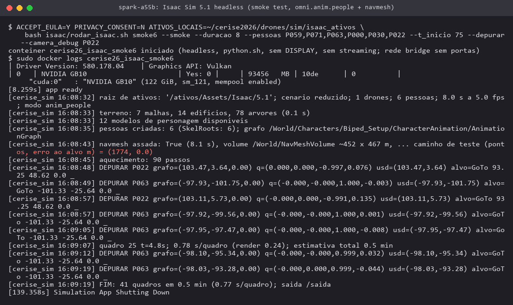
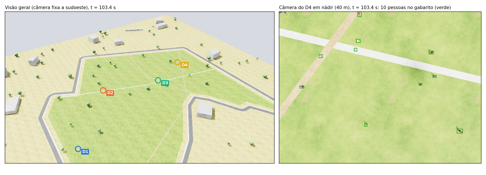
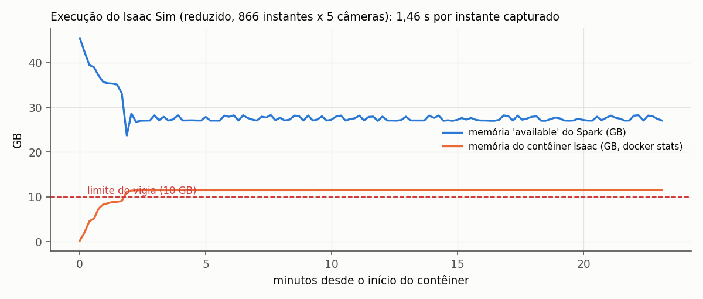
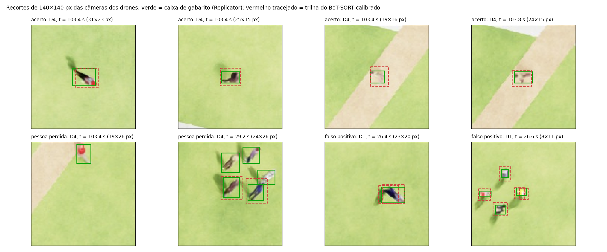
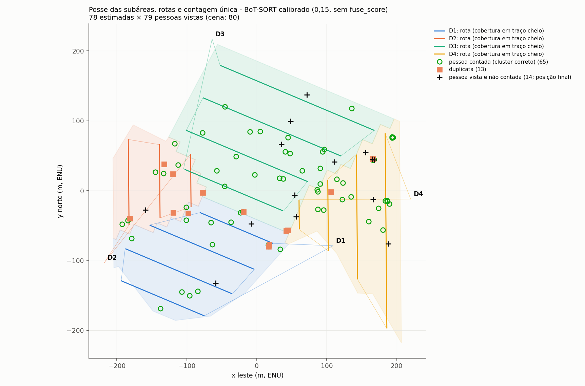
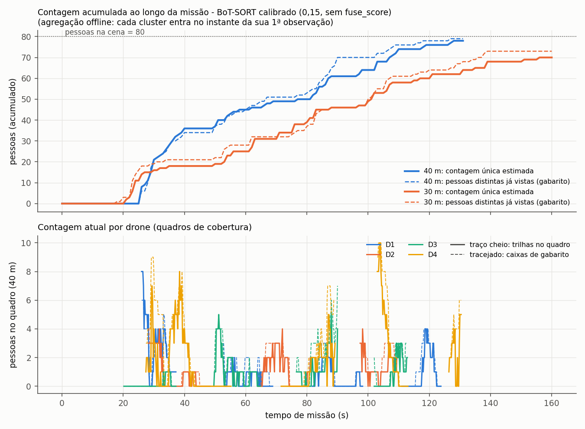
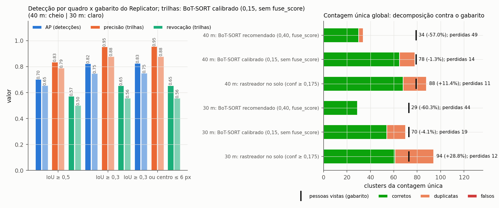
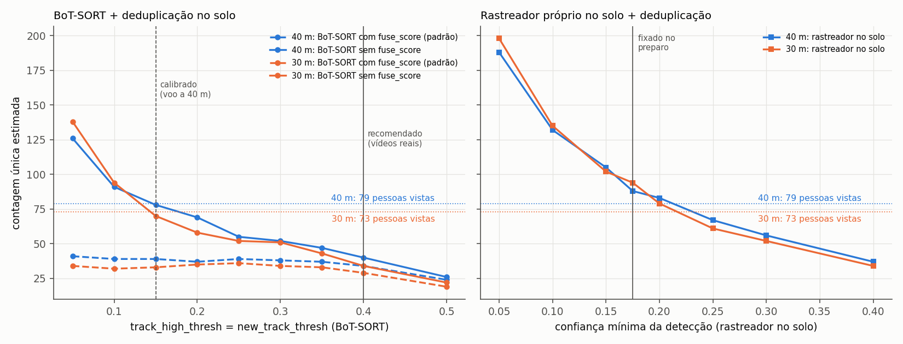
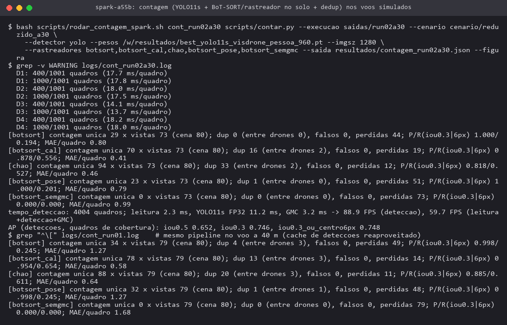

# Simulação 3D de drones contando pessoas no Campus Samambaia (Isaac Sim 5.1, DGX Spark)

Repositório: <https://github.com/EduardoCaixeta/cerise-2026-drones-segmentacao> (pasta `simulacao/`).
Execução: DGX Spark (NVIDIA GB10, memória unificada de 128 GB, máquina de produção compartilhada), 26/10/2026,
imagem oficial `nvcr.io/nvidia/isaac-sim:5.1.0` (arm64) e contêiner `cerise26_drones_sim` (PyTorch NGC 26.05 + ultralytics 8.4.189).

## 1. Objetivo

Esta atividade completa o Objetivo 5 do plano de trabalho (detecção e contagem de pessoas com múltiplos drones). Ela fecha o
ciclo entre três etapas anteriores da frente de drones: a partição da área e as rotas (DARP + refinamento), o detector
(YOLO11s ajustado no VisDrone) e a validação em vídeos reais (VisDrone2019-MOT). Para isso, foi construída uma **simulação 3D
fotorrealista**: quatro drones percorrem a área aberta da UFG pelas rotas planejadas, enquanto **pessoas animadas** caminham,
param e cruzam as fronteiras entre subáreas. Cada câmera grava RGB, caixas 2D de gabarito e a pose. A partir dessas gravações,
foram medidos três aspectos contra um gabarito exato:

- a detecção por quadro;
- a contagem por quadro;
- a **contagem única global**: pessoas distintas na missão inteira, deduplicadas entre passagens e entre drones.

## 2. Ambiente, licença e salvaguardas

- **Licença.** A *NVIDIA Isaac Sim Additional Software and Materials License* foi aceita em 26/10/2026
  (~11:10). Por isso, os contêineres sobem com `ACCEPT_EULA=Y` e **`PRIVACY_CONSENT=N`** (sem telemetria).
- **Ativos.** Os ativos do Isaac foram baixados do servidor oficial da NVIDIA (S3 público configurado na imagem) para um espelho
  local em `~/cerise2026/drones/sim/isaac_ativos`: **83 arquivos, 0,55 GB**. O espelho contém 12 personagens de
  `Isaac/People/Characters`, o `Biped_Setup`, as animações e o esqueleto `biped_demo`, este último faltante na lista do preparo.
- **Execução headless.** Todo o processamento rodou sem tela: `python.sh` + `SimulationApp({"headless": True})`, sem `DISPLAY`
  e sem *streaming*. Os contêineres usaram rede *bridge* sem portas publicadas, e nada foi exposto à internet. A tela física do
  quiosque não foi usada.
- **Proteções da produção.** O contêiner ficou limitado a `--cpus 8` com prioridade baixa de CPU. Um vigia de memória registrou a
  memória *available* e interromperia o contêiner abaixo de 10 GB. O worker do servidor 3D **não** foi parado: havia 45 GB
  *available* no início, acima do limiar de 30 GB.
- **Incidente.** Houve um incidente de memória no cenário "completo", descrito na seção 6.4.

## 3. Cenário (gerado na etapa de preparo, sem alteração)

| Item | `reduzido` (voo a 40 m) | `reduzido_a30` (voo a 30 m) |
|---|---|---|
| Área (recorte da área aberta da UFG, ENU local) | 11,27 ha | 11,27 ha |
| Drones (frota A/B/C/A, DARP + refinamento) | 4, nádir, 1280×960 HFOV 70° (D3: 1280×720 HFOV 82°) | idem, a 30 m |
| Duração do plano / quadros por câmera (5 fps) | 173 s / 866 | 200 s / 1.001 |
| Pessoas | 80: 36 caminhantes, 14 em grupos andando, 12 em rodas paradas, 10 paradas, 8 que cruzam fronteiras | idem |
| Terreno | malhas com UV do polígono OSM, rua, calçada, caminhos, 14 edifícios esquemáticos, 78 árvores, texturas procedurais (sem satélite) | idem |

## 4. Simulação no Isaac Sim

### 4.1 Montagem do palco e gravação

O script `isaac/sim_ufg_isaac.py` monta o palco a partir de `cena.json`, usando OmniPBR com texturas próprias, sol
(*DistantLight*) e céu (*DomeLight*). Em seguida:

- **Pessoas.** Cria os personagens com o grafo de animação do `Biped_Setup` e o script de comportamento do `omni.anim.people`,
  que executa os comandos `GoTo`/`Idle`/`LookAround` do plano sobre uma **navmesh** assada na área.
- **Drones.** Move as câmeras USD dos drones pela trajetória temporizada, com os intrínsecos de `cenario.json`.
- **Gravação.** O Replicator grava, a 5 fps, por câmera: `rgb` (JPEG), `bounding_box_2d_tight` (pessoa identificada pelo
  `primPath`), `camera_params` e a pose. O **gabarito de posição é a posição real** de cada personagem, lida do grafo de animação a
  cada quadro: 69.280 leituras no voo a 40 m, nenhuma por *fallback*.

### 4.2 Smoke tests

Os testes de fumaça usaram 1 drone, 6 pessoas e 4 a 8 s de simulação. O RTX inicializou sem erro no GB10 (driver 580.178.04,
Vulkan). A primeira compilação de shaders mais a execução levaram ~2 min. Os testes revelaram quatro divergências de API,
todas corrigidas no script:

| # | Sintoma observado | Causa | Correção |
|---|---|---|---|
| 1 | `Type mismatch for variable Action/Walk` (2.548 avisos); personagens em pose fixa; gabarito com posição (0, 0) | `Biped_Setup.usd` referencia `biped_demo/biped_demo_meters.usd`, ausente do espelho, e o grafo não compilava sem esqueleto | pasta `biped_demo/` incluída em `baixar_ativos.py` |
| 2 | pessoas andando em linha reta em direções arbitrárias | a navmesh cobria só ±4,5 m em torno da origem: o `TransformPrim` sobre o volume padrão não teve efeito no 5.1, e os caminhos eram truncados no limite do volume | extensão e *xformOps* do `NavMeshVolume` definidas diretamente, mais um teste automático de caminho longo (1.778 pontos, erro de 0,0 m ao alvo) |
| 3 | sombra ampliada do modelo visual do drone (5×) aparecendo na própria câmera | o modelo visual é ampliado para a visão geral | `primvars:doNotCastShadows` no modelo visual |
| 4 | modo cinemático (`set_world_transform` a cada passo) deixava o personagem "deslizando" sem animar as pernas | o grafo não anima com a transformada sobrescrita | modo `anim_people` (navmesh) adotado; o cinemático ficou só como alternativa documentada |

As caixas do Replicator foram conferidas contra a projeção do gabarito de posição (centro do corpo a 0,85 m) pela pose gravada da
câmera. Em 82 caixas, o erro mediano foi de **2,8 px** e o máximo de 5,8 px, o que confirma as convenções de pose (OpenCV↔USD↔ENU)
usadas na contagem. Uma câmera de depuração que segue uma pessoa mostrou a caminhada animada na direção do alvo do plano.

### 4.3 Renderizações

| Execução | Câmeras | Instantes | Tempo de laço | s por instante (render) | Memória do contêiner (`docker stats`) | Menor *available* do Spark |
|---|---|---|---|---|---|---|
| `run01` (40 m) | 4 drones + visão geral 1920×1080 | 866 | 21,0 min | 1,46 (0,48) | 11,5 GB | 24,3 GB |
| `run02a30` (30 m) | 4 drones | 1.001 | 21,0 min | 1,26 (0,41) | 11,4 GB | 24,2 GB |

A memória *available* do Spark caiu de ~45 GB para ~27 GB durante as duas execuções. A pegada total foi de ~18 a 21 GB,
incluindo alocações de GPU que o `docker stats` não contabiliza. Em todo momento a folga ficou acima de 10 GB.
Cada execução gera cerca de 0,8 GB de JPEG. O tamanho medido das pessoas foi:

- **40 m:** maior lado mediano da caixa de gabarito de **21 px** (p10 14, p90 30), em 1.891 caixas de quadros de cobertura;
- **30 m:** **31 px** (p10 18, p90 41), em 1.612 caixas.

Esses valores são menores que os 26,7 px estimados no preparo com um cilindro, porque a pessoa real vista de cima é mais estreita.

## 5. Pipeline de contagem

O fluxo é: quadros + pose → **YOLO11s ajustado** (FP32, `imgsz` 1280) → detecções em cache (confiança ≥ 0,01, NMS 0,6, como
no protocolo dos vídeos reais) → rastreamento → projeção de cada caixa no solo (raio do pixel com a pose; centro da caixa a
0,85 m) → **posse da subárea** com faixa de fronteira de 6 m → **deduplicação espaço-temporal** pela posição no solo, e não
pelos IDs. Foram avaliados os seguintes rastreadores:

- **BoT-SORT recomendado:** a configuração escolhida na validação em vídeos reais (val do VisDrone2019-MOT), com GMC
  *sparseOptFlow*, `track_high` = `new` = 0,40, `low` = 0,05, *buffer* de 30 quadros e os demais parâmetros no padrão do
  ultralytics, inclusive `fuse_score`. Foi **pré-registrada** antes do render.
- **Rastreador no solo:** o rastreador próprio da etapa de preparo, com associação húngara em metros e portão pela velocidade de
  caminhada. Usa confiança ≥ 0,175, valor fixado antes do render.
- **Ablações:** BoT-SORT com GMC pela telemetria (pose) e BoT-SORT sem GMC.
- **BoT-SORT calibrado:** sem `fuse_score`, com `high` = `new` = 0,15. Foi escolhido **a posteriori** no voo a 40 m pela varredura
  da seção 6.3 e aplicado **sem alteração** ao voo a 30 m, que funciona como teste.

A avaliação, em `cerise_sim/avaliacao.py`, usa apenas os quadros de cobertura e mede:

- a AP por quadro, agregada sobre todos os quadros;
- precisão e revocação para IoU ≥ 0,5, IoU ≥ 0,3 e IoU ≥ 0,3 ou centro a até 6 px;
- o erro absoluto médio (MAE) e o viés da contagem por quadro;
- a contagem única decomposta em clusters corretos, duplicatas (entre drones ou do mesmo drone), falsos e pessoas perdidas.

O pacote ganhou o módulo `cerise_sim/botsort_chao.py` (BoT-SORT do ultralytics com GMC pré-calculada e projeção das trilhas no
solo), a AP em `avaliacao.py`, a varredura `scripts/varredura_botsort.py` e as figuras. Os testes passaram de 14 para
**17 aprovados** no Spark: AP, GMC pela pose e BoT-SORT no solo com oráculo (`evidencias/sim_18_terminal_pytest_17_testes.png`).

## 6. Resultados

### 6.1 Detecção e contagem por quadro

Tabela: Detecção por quadro contra as caixas de gabarito do Replicator (quadros de cobertura; 1.891 caixas a 40 m e 1.612 a 30 m)
| Voo | AP IoU 0,5 | AP IoU 0,3 | P / R a conf ≥ 0,175 (IoU 0,3 ou 6 px) | P / R a conf ≥ 0,40 | Trilhas BoT-SORT calibrado: P / R / MAE por quadro | Trilhas BoT-SORT recomendado: P / R / MAE |
|---|---|---|---|---|---|---|
| 40 m | **0,702** | 0,823 | 0,885 / 0,611 | 0,998 / 0,230 | 0,954 / 0,654 / 0,58 | 0,998 / 0,245 / 1,27 |
| 30 m | 0,652 | 0,746 | 0,818 / 0,527 | 0,997 / 0,180 | 0,878 / 0,556 / 0,41 | 1,000 / 0,194 / 0,80 |

O detector **localiza** bem as pessoas simuladas: AP de 0,70 a IoU 0,5, com revocação máxima de 0,84 a 40 m. Porém, as
**pontuações são baixas e mal calibradas** no domínio simulado. No limiar 0,40, usado pelo rastreador recomendado, a precisão é
quase perfeita (0,998), mas a revocação cai para 0,23. O voo a 30 m, com pessoas 48 % maiores em pixels, **não** melhorou a
detecção (AP de 0,65; queda maior no D2). Uma hipótese é que a pessoa vista de cima em maior resolução se afaste mais da
aparência oblíqua do VisDrone. A contagem por quadro tem erro absoluto médio de 0,4 a 0,6 pessoa por quadro, com 1,7 pessoa por
quadro em média no gabarito a 40 m, e viés negativo, isto é, subcontagem.

### 6.2 Contagem única global

Tabela: Contagem única global contra as pessoas distintas vistas no gabarito (40 m: 79 de 80; 30 m: 73 de 80)
| Voo | Rastreador | Contagem única | Erro vs. vistas | Corretos | Duplicatas (entre drones / mesmo drone) | Falsos | Perdidas | Soma ingênua de detecções |
|---|---|---|---|---|---|---|---|---|
| 40 m | BoT-SORT recomendado (pré-registrado) | 34 | −57,0 % | 30 | 4 (3 / 1) | 0 | 49 | 465 |
| 40 m | rastreador no solo (pré-registrado) | 88 | +11,4 % | 68 | 20 (3 / 17) | 0 | 11 | 1.306 |
| 40 m | BoT-SORT calibrado (escolhido neste voo) | 78 | −1,3 % | 65 | 13 (3 / 10) | 0 | 14 | 1.296 |
| 40 m | BoT-SORT com GMC pela pose / sem GMC | 32 / 0 | −59,5 % / −100 % | 31 / 0 | 1 / 0 | 0 | 48 / 79 | 464 / 0 |
| 30 m | BoT-SORT recomendado | 29 | −60,3 % | 29 | 0 | 0 | 44 | 313 |
| 30 m | rastreador no solo | 94 | +28,8 % | 61 | 33 (2 / 31) | 0 | 12 | 1.039 |
| 30 m | **BoT-SORT calibrado (teste)** | 70 | **−4,1 %** | 54 | 16 (2 / 14) | 0 | 19 | 1.021 |

Os resultados se resumem em cinco pontos:

1. **Contar detecções ou IDs não funciona.** A soma ingênua de detecções dá 16 vezes o número real de pessoas (1.306 contra 79), e
   o BoT-SORT gerou 150 IDs brutos para 79 pessoas. A deduplicação no solo é indispensável.
2. **A configuração recomendada pelos vídeos reais não transfere.** O BoT-SORT pré-registrado subconta 57 % a 60 %, com zero falsos
   positivos, mas com 44 a 49 pessoas nunca contadas. A varredura (seção 6.3) mostra a causa: o `fuse_score` multiplica a IoU
   pela pontuação da detecção. Com pontuações de 0,1 a 0,3, nenhuma trilha nova é confirmada, e baixar o limiar não resolve
   (34 a 41 pessoas para qualquer limiar).
3. **A GMC é necessária.** Sem compensação de movimento, nada é rastreado. A 5 fps, o deslocamento da imagem entre quadros
   consecutivos supera o tamanho da pessoa (21 a 31 px). Esse deslocamento foi medido pela GMC, como mediana por drone:
   28 a 53 px a 40 m e 38 a 71 px a 30 m. A GMC por fluxo óptico nas imagens difere da GMC exata calculada pela pose em 0,8 a
   2,0 px (mediana; `resultados/gmc_imagem_vs_pose.json`) e deu o mesmo resultado (34 contra 32).
4. **O BoT-SORT calibrado** (sem `fuse_score`, limiar 0,15), escolhido no voo a 40 m (−1,3 %), errou −4,1 % no voo a 30 m, que não
   participou da escolha. O total próximo do correto, porém, resulta da compensação entre 16 duplicatas e 19 perdidas. Apenas 54
   das 73 pessoas foram contadas corretamente, e o erro absoluto (duplicatas + perdidas) é de 48 % das pessoas vistas.
5. **Duplicatas.** A maioria vem do **mesmo drone**: 10 de 13 e 14 de 16 no BoT-SORT calibrado. São pessoas andando, revistas na
   faixa seguinte da varredura depois do intervalo máximo de reassociação, ou trilhas fragmentadas. A posse da subárea e a faixa
   de fronteira limitaram as duplicatas **entre drones** a 2 ou 3 por voo. Das 8 pessoas que cruzam fronteiras, duas geraram
   duplicata e duas não foram contadas a 40 m. A agregação estática do `cerise_drones` sobre as mesmas trilhas deu 84 (40 m) e
   62 (30 m), por não modelar o movimento.

### 6.3 Sensibilidade (diagnóstico a posteriori)

A varredura, com 26 configurações por voo sobre o mesmo cache de detecções e menos de 2 s cada, mostra três comportamentos:

- **Rastreador no solo.** A contagem cai monotonamente com a confiança mínima: 188 → 132 → 105 → 88 → 83 → 67 → 56 → 37 entre
  0,05 e 0,40, a 40 m. O valor certo depende de uma calibração que só existe a posteriori.
- **BoT-SORT com `fuse_score`.** A contagem fica achatada entre 24 e 41 para qualquer limiar.
- **BoT-SORT sem `fuse_score`.** O comportamento passa a ser análogo ao do rastreador no solo: 126 → 91 → 78 → 69 entre 0,05 e
  0,20, a 40 m.

As curvas dos dois voos são parecidas, o que sustenta a transferência da escolha de 40 m para 30 m.

### 6.4 Desempenho e incidente de memória

- **Vazão.** Detecção YOLO11s FP32 a 1280 px: 12,2 ms por quadro, ou **82 FPS**, a 40 m, e 11,2 ms (89 FPS) a 30 m. Com leitura
  e GMC, a vazão foi de **56 a 60 FPS**. Rastreamento e agregação levaram menos de 2 s por voo. A contagem não é o gargalo: o
  render custa de 1,3 a 1,5 s por instante.
- **Cenário "completo" (34,23 ha, 120 pessoas): não renderizado.** A navmesh desse cenário cobre 1.330 × 998 m, 6,3 vezes a área
  da do reduzido. Sua assadura consumiu mais de 34 GB de memória unificada em ~22 s: a memória *available* caiu de 36,5 GB para
  2,5 GB entre 14:03:22 e 14:03:44. O vigia, que lia a cada 10 s e usava `docker stop -t 20`, detectou a queda e interrompeu o
  contêiner, mas não a tempo de evitar um **OOM global** às 14:03:57. O OOM encerrou:
  - processos de áudio e D-Bus da tela de login (gdm, que se reiniciou sozinha);
  - o D-Bus/PipeWire da sessão não gráfica do usuário;
  - o processo Python do worker do servidor 3D, cujo contêiner se reiniciou sozinho e voltou com `"status":"ok"`, 1 worker e o
    modelo carregado em 110 s.

  **Os serviços de produção não foram afetados:** `vllm-server` (`/v1/models` respondendo), `vllm-embed`, `vllm-stt` e `qdrant`
  seguiram no ar, e `vania-brain` (HTTP 200) e `ollama` também. Pelos registros (`loginctl`, `last` e `journalctl` desde o
  *boot* das 09:02), não havia sessão gráfica do usuário, isto é, do quiosque, no seat0 nesse dia. O autologin está desabilitado
  e o seat0 exibia o *greeter* do gdm, que o OOM reiniciou. Como correção, `rodar_isaac.sh` agora
  impõe `--memory 24g` ao contêiner, e o vigia passou a ler a cada 2 s e usar `docker kill` com limiar de 12 GB. O cenário
  completo **não** foi tentado de novo, e seu render fica como pendência (navmesh por partes ou resolução maior da célula).

### 6.5 Vídeo

`evidencias/sim_video_run01.mp4` é um H.264 de 1920×1080, 15 quadros/s (3× o tempo real), 57,7 s e 15,5 MB. Ele mostra a visão
geral com os drones identificados e o rastro de cada um, os quatro painéis das câmeras com caixas de gabarito (verde) e trilhas
com o ID do cluster (vermelho), e o painel com a contagem atual por drone e a acumulada (estimada × gabarito). As trilhas e a
contagem do vídeo são as do BoT-SORT calibrado.

## 7. Limitações

- **Sim → real.** O terreno, as texturas e os edifícios são procedurais e esquemáticos, não correspondem aos prédios reais da UFG,
  e a iluminação é fixa (sol a 55°). Há só 12 modelos de personagem. O detector foi ajustado em imagens oblíquas reais, e as
  pontuações mudaram de escala no domínio simulado. Os números medem o pipeline nesse domínio e não estimam diretamente o erro em
  campo.
- **Cinemática dos drones.** As câmeras seguem a trajetória planejada com atitude ideal (sem vento, vibração, *rolling shutter*,
  borrão de movimento, compressão de vídeo ou erro de GNSS/atitude). A pose usada na projeção é exata. O plano B com PX4 SITL
  (`gazebo/`) não foi necessário e não foi compilado.
- **Pessoas.** O `omni.anim.people` usa velocidade de caminhada fixa, ignorando as velocidades do plano (0,8 a 1,7 m/s), e desvio
  dinâmico. O gabarito vem do simulador, mas as caixas *tight* de personagens sob copas não têm razão de oclusão (`-1`).
- **Amostra pequena.** São um recorte de 11,3 ha, 80 pessoas e dois voos. O BoT-SORT calibrado foi escolhido no voo a 40 m e
  testado em um único voo (30 m), e a altitude e o plano de voo variam juntos entre os dois. A captura a 5 fps vem do plano (fixo
  para o render), enquanto o rastreamento recomendado foi calibrado em vídeo de 25 a 30 fps.
- **Cenário completo** não renderizado (seção 6.4).

## 8. Próximos passos

1. Calibrar as pontuações do detector no domínio simulado (ou ajustar o YOLO com imagens sintéticas do Replicator, que já
   traz gabarito) e escolher os limiares em voos de calibração distintos dos de teste.
2. Repetir o `completo` com navmesh por subárea, `--memory` e o vigia novo; variar iluminação, resolução (`--largura 1920`) e
   inclinação da câmera.
3. Reduzir duplicatas do mesmo drone: reassociação com velocidade estimada entre faixas vizinhas da varredura e intervalo
   máximo adaptado ao tempo de retorno da faixa.
4. Validar em voo real no Campus Samambaia com telemetria (pose) e anotação de pessoas.

## Arquivos

- Código: `isaac/sim_ufg_isaac.py`, `isaac/rodar_isaac.sh`, `isaac/vigia_memoria.sh`, `isaac/baixar_ativos.py`,
  `cerise_sim/botsort_chao.py`, `cerise_sim/avaliacao.py`, `scripts/contar.py`, `scripts/varredura_botsort.py`,
  `scripts/video_relatorio.py`, `scripts/montar_video.sh`, `scripts/figuras_sim.py`, `scripts/figura_amostras.py`.
- Resultados medidos: `resultados/contagem_run01.json`, `contagem_run02a30.json` (todas as métricas, séries temporais e
  clusters), `varredura_run01.json`, `varredura_run02a30.json`, `medidas_render.json`, `contagem_*_cache_det.npz` (detecções +
  GMC) e `logs/` (logs do Isaac e da contagem, `meta_*.json`, vigias e o `dmesg` do OOM).
- As saídas brutas (JPEG, ~0,8 GB por voo) ficam no Spark em `~/cerise2026/drones/sim/saidas/{run01,run02a30}`, fora do git.
