# Validação da contagem de pessoas em vídeos reais de drone (VisDrone2019-MOT)

Repositório: `cerise-2026-drones-segmentacao` (GitHub, organização do CERISE), pasta `validacao_videos/`.
Execução: DGX Spark (NVIDIA GB10), contêiner `cerise26_drones` (PyTorch 2.12 NGC 26.05 + ultralytics 8.4.189), 26/10/2026.

## 1. Objetivo

A etapa anterior da frente de drones ajustou um YOLO11s para a classe única "pessoa" no VisDrone2019-DET e mediu
mAP e erro de contagem em **imagens estáticas**. Para a missão de contagem no Campus Samambaia, porém, o drone produz
**vídeo**: a mesma pessoa aparece em dezenas de quadros e o número de interesse é, além da ocupação instantânea, o
**número de pessoas distintas** observadas. Esta atividade mede, em vídeo aéreo real com gabarito de identidades, (i) o
erro de contagem por quadro, (ii) o erro da contagem de pessoas únicas obtida pelos identificadores (IDs) de um
rastreador multiobjeto, (iii) as métricas padronizadas de rastreamento (HOTA, MOTA, IDF1) da classe pessoa e (iv) a
vazão do pipeline no GB10, analisando a influência de densidade, escala (altitude), iluminação e movimento de câmera.

## 2. Dados

**Fonte.** VisDrone2019-MOT (AISKYEYE, Universidade de Tianjin; Zhu et al., *Detection and Tracking Meet Drones
Challenge*, IEEE TPAMI 2021), partições **val** (7 sequências, 2.846 quadros) e **test-dev** (17 sequências, 6.635
quadros, gabarito público), obtidas pelos links oficiais do Google Drive listados em
<https://github.com/VisDrone/VisDrone-Dataset>. O Drive devolveu de forma intermitente a página *Quota exceeded*;
foi escrito um downloader resumível (`scripts/00_baixar_visdrone_mot.py`) que pede o intervalo restante em uma única
conexão e espera quando recebe HTML. Arquivos obtidos: `VisDrone2019-MOT-val.zip` (1.602.397.759 B, SHA-256
`e53571990dfc79229e0a8ae10264bc4fa604a027c44b06e3a097417e4fa55705`) e `VisDrone2019-MOT-test-dev.zip`
(2.293.482.321 B, SHA-256 `758abe40bf20246e7e778ac61eaa557cf004b034b6e68e85006e5add68e17eb5`), íntegros pelo
`testzip` (Figura v08). Os dados ficam em `~/cerise2026/drones/mot` no Spark (7,4 GB), fora do git. O repositório
oficial não traz arquivo de licença; o conjunto é distribuído pelos autores como *benchmark* acadêmico com pedido de
citação, e aqui foi usado apenas para avaliação, sem redistribuição. Não foi necessário recorrer a alternativas
(Stanford Drone Dataset, Okutama-Action, UAVDT).

**Gabarito.** Pessoa = `pedestrian` (1) ∪ `people` (2), com `score = 1`; 37 identidades aparecem com as duas
classes e são tratadas como uma só pessoa. Regiões `ignored` (0) e `others` (11) são excluídas: caixas do gabarito e
do rastreador com mais de 50 % da área dentro delas são descartadas, como no protocolo do VisDrone. Há 332 pessoas
distintas no val e 1.012 no test-dev; a sequência `uav0000370_00001_v` (test-dev) não contém pessoas e entra só nas
métricas que admitem gabarito vazio. As cenas são, na maioria, oblíquas e urbanas, com resoluções de 680×382 a
3840×2160, três sequências noturnas (luminância média < 70) e densidades de 1 a 109 pessoas/quadro (Figura v00).

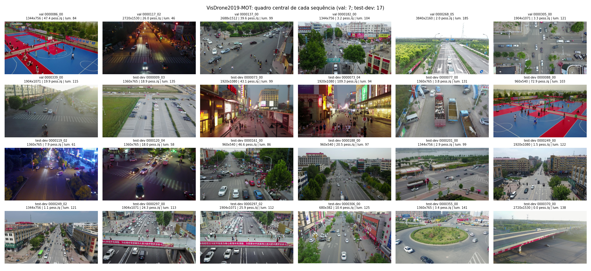

## 3. Metodologia

### 3.1 Detectores

Quatro variantes, todas em FP32 (o FP16 gera NaN no GB10 com o PyTorch 2.12 do NGC 26.05), confiança mínima 0,01,
NMS IoU 0,6, até 1.000 caixas: **YOLO11s ajustado** (VisDrone-DET, classe pessoa) a 960 px (resolução do treino) e a
1280 px, e **YOLO11s COCO** (classe `person`) a 960 e 1280 px como referência. Cada quadro é decodificado uma vez e
passa pelas quatro variantes; as detecções ficam em cache (`10_detectar.py`, 9.481 quadros em 7,7 min; pico de 1,0 GB
de GPU alocado, limite imposto de 7,5 GB; Figura v09).

### 3.2 Rastreadores

Foram usados os rastreadores do próprio ultralytics, **sem modificação de código**: `BYTETracker` (ByteTrack) e
`BOTSORT` (BoT-SORT, GMC *sparseOptFlow* com redução 2×, sem ReID). O rastreamento é feito *offline* sobre as
detecções em cache, alimentando `tracker.update()` com objetos `Boxes`, exatamente como o *callback*
`on_predict_postprocess_end` faz em `model.track()`. A compensação de movimento de câmera (GMC), que não depende das
detecções nem dos limiares, é calculada uma vez por sequência sobre os quadros reais (`20_gmc_condicoes.py`) e
injetada no BoT-SORT, de modo que todas as configurações compartilham as mesmas matrizes. Parâmetros-base (padrão do
ultralytics): `track_high_thresh` 0,25, `track_low_thresh` 0,1, `new_track_thresh` 0,25, `track_buffer` 30 quadros,
`match_thresh` 0,8, `fuse_score` ativo; BoT-SORT com `proximity_thresh` 0,5 e `appearance_thresh` 0,8 (inativos sem
ReID).

### 3.3 Protocolo sem vazamento

Todas as escolhas foram feitas **apenas no val** e aplicadas sem alteração ao test-dev:

1. **Grade de rastreamento** (34 configurações por combinação, 1.904 execuções): `track_high_thresh` =
   `new_track_thresh` ∈ {0,10; 0,15; 0,20; 0,25; 0,30; 0,40; 0,50; 0,60; 0,70}, `track_low_thresh` ∈ {0,05; 0,10}
   (< alto), `track_buffer` ∈ {30; 60}. Critério: maior **HOTA** combinado no val. Uma primeira grade até 0,50 foi
   ampliada até 0,70 porque o ótimo do detector ajustado caiu na borda; a escolha não mudou (Figura v06).
2. **Limiar τ da contagem por quadro a partir das detecções** (sem rastreador): τ ∈ [0,05; 0,70], passo 0,025,
   menor MAE no val.
3. **Comprimento mínimo de trilha L** para a contagem de pessoas únicas (um ID só conta se aparecer em ≥ L quadros):
   L ∈ {1, 3, 5, 10, 15, 20, 30, 45, 60, 90, 120, 180}, menor erro relativo absoluto médio por sequência no val.

A **combinação principal** é a de maior HOTA no val entre as variantes do detector ajustado (YOLO11s ajustado 960 +
BoT-SORT); a **referência** é a de maior HOTA no val entre as variantes COCO (YOLO11s COCO 1280 + BoT-SORT).

### 3.4 Métricas

- **Contagem por quadro:** MAE, RMSE, MAPE (sobre quadros com gabarito > 0) e viés (média de previsto − real),
  comparando o número de pessoas anotadas visíveis (após a exclusão das regiões ignoradas) com (a) o número de
  detecções com confiança ≥ τ e (b) o número de trilhas ativas no quadro.
- **Pessoas únicas:** número de IDs do gabarito × número de IDs do rastreador (com ≥ L quadros), por sequência
  (erro relativo) e somado. A inflação é decomposta, a partir do casamento quadro a quadro do CLEAR (IoU ≥ 0,5), em
  *IDs falsos* (nunca casados com pessoa), *IDs extras por troca/fragmentação* (IDs casados − pessoas casadas) e
  *pessoas nunca rastreadas*; por construção, IDs − pessoas = falsos + extras − nunca rastreadas.
- **Rastreamento:** HOTA (média em α = 0,05…0,95; DetA, AssA, LocA), CLEAR (MOTA, MOTP, IDSW, MT/ML, Frag) e
  Identity (IDF1), com IoU como similaridade e agregação entre sequências idêntica à do TrackEval. As três métricas
  foram reimplementadas em `scripts/metricas_mot.py` seguindo linha a linha o TrackEval (Luiten et al., IJCV 2021),
  porque o TrackEval original exige adaptação ao numpy ≥ 1.24. A implementação foi verificada por casos sintéticos
  com resultado analítico (rastreador perfeito, uma troca de ID, um falso positivo por quadro) e contra o
  **py-motmetrics 1.4.0** em 72 pares sequência×combinação: IDF1 idêntico (diferença máxima 0) e MOTA com
  diferença máxima de 0,0026 (média 0,00015), atribuível à convenção de contagem de trocas de ID (Figura v12).
- **Vazão:** pipeline em fluxo (lote 1), medindo separadamente leitura/decodificação JPEG, detecção (inclui pré e
  pós-processamento) e rastreador (inclui GMC), em 300 quadros de uma sequência 4K e de uma 1344×756 (`40_fps.py`).

### 3.5 Execução no Spark de produção

Jobs de GPU somente com ≥ 25 GB de memória "available" (folga ≥ 10 GB além do job), `nice 19`, contêineres
`cerise26_drones_vv_*` com `--cpus` 2–6; o Spark estava com carga média de 26–33 (20 núcleos) devido à
re-renderização do *dataset* do braço, o que torna as medidas de tempo conservadoras. Nenhum serviço de produção,
porta ou contêiner de outros projetos foi alterado.

## 4. Resultados

### 4.1 Configurações escolhidas no val

| Detector | Rastreador | `high`=`new` | `low` | buffer | HOTA val | L |
|---|---|---|---|---|---|---|
| YOLO11s ajustado 960 | ByteTrack | 0,40 | 0,05 | 30 | 0,338 | 60 |
| YOLO11s ajustado 960 | **BoT-SORT** | 0,40 | 0,05 | 30 | **0,390** | 60 |
| YOLO11s ajustado 1280 | ByteTrack | 0,50 | 0,05 | 30 | 0,323 | 45 |
| YOLO11s ajustado 1280 | BoT-SORT | 0,50 | 0,05 | 60 | 0,373 | 60 |
| YOLO11s COCO 960 | ByteTrack | 0,25 | 0,05 | 60 | 0,312 | 15 |
| YOLO11s COCO 960 | BoT-SORT | 0,30 | 0,05 | 30 | 0,358 | 10 |
| YOLO11s COCO 1280 | ByteTrack | 0,30 | 0,05 | 60 | 0,351 | 30 |
| YOLO11s COCO 1280 | **BoT-SORT** | 0,30 | 0,05 | 30 | **0,402** | 30 |

O detector ajustado prefere limiares altos (0,40–0,50): ele recupera mais pessoas pequenas, mas com pontuações
menos calibradas e mais caixas espúrias, e o limiar de criação de trilhas é o principal controle de falsos IDs.
Os limiares τ escolhidos para a contagem por detecções foram 0,350 (ajustado 960), 0,325 (ajustado 1280), 0,100
(COCO 960) e 0,125 (COCO 1280).

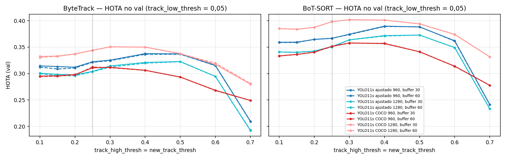

### 4.2 Rastreamento de pessoas no test-dev

| Combinação (config. do val) | HOTA | DetA | AssA | MOTA | IDF1 | IDSW | MT | ML |
|---|---|---|---|---|---|---|---|---|
| ajustado 960 + ByteTrack | 0,286 | 0,263 | 0,321 | 0,095 | 0,339 | 1.639 | 169 | 408 |
| **ajustado 960 + BoT-SORT** | **0,328** | **0,281** | 0,391 | 0,092 | 0,399 | 974 | **221** | **352** |
| ajustado 1280 + ByteTrack | 0,279 | 0,244 | 0,328 | 0,093 | 0,340 | 1.116 | 133 | 465 |
| ajustado 1280 + BoT-SORT | 0,314 | 0,261 | 0,386 | 0,087 | 0,389 | 610 | 169 | 426 |
| COCO 960 + ByteTrack | 0,256 | 0,188 | 0,356 | 0,180 | 0,297 | 708 | 108 | 626 |
| COCO 960 + BoT-SORT | 0,292 | 0,205 | 0,421 | 0,193 | 0,352 | **375** | 138 | 584 |
| COCO 1280 + ByteTrack | 0,291 | 0,232 | 0,373 | 0,208 | 0,349 | 857 | 158 | 543 |
| **COCO 1280 + BoT-SORT** | **0,328** | 0,249 | **0,441** | **0,214** | **0,406** | 444 | 200 | 490 |

Com os parâmetros padrão do ultralytics, os HOTA no test-dev foram 0,269/0,306 (ajustado 960, ByteTrack/BoT-SORT),
0,268/0,306 (ajustado 1280), 0,256/0,287 (COCO 960) e 0,287/0,322 (COCO 1280); a calibração no val melhorou o HOTA
em 0,000–0,022 e reduziu as trocas de ID do detector ajustado em 36–64 % (ex.: 2.555 → 1.639 e 1.754 → 974).

As duas melhores combinações empatam em HOTA no test-dev (0,328), mas por caminhos opostos: o detector ajustado tem
maior detecção (DetRe 0,358 × 0,278; MT 221 × 200; ML 352 × 490) e menor precisão (DetPr 0,458 × 0,574) e
localização (LocA 0,717 × 0,744), o que derruba o MOTA (0,092 × 0,214), métrica dominada por falsos positivos. O
**BoT-SORT supera o ByteTrack em todas as combinações** (+0,035 a +0,042 de HOTA; −41 % a −48 % de IDSW). A ablação
(`32_ablacao_gmc.py`) atribui essa vantagem à **compensação de movimento de câmera**: sem GMC, o ajustado 960 +
BoT-SORT cai para HOTA 0,289, IDF1 0,343 e 1.589 IDSW (com GMC: 0,328; 0,399; 974), praticamente igual ao ByteTrack;
para o COCO 1280, de 0,328/0,406/444 para 0,295/0,354/794. Em vídeo de drone, mesmo pequenos movimentos da câmera
deslocam todas as caixas e quebram a associação por IoU.

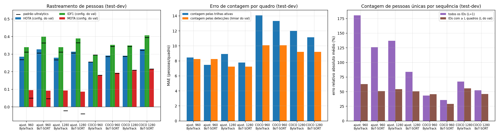

### 4.3 Contagem por quadro

| Detector | τ (val) | MAE val | MAE test-dev | RMSE test-dev | MAPE test-dev | viés test-dev | MAE test-dev pelas trilhas (BoT-SORT) |
|---|---|---|---|---|---|---|---|
| ajustado 960 | 0,350 | 7,72 | 8,24 | 16,06 | 57,8 % | −5,84 | **7,46** (viés −4,52) |
| ajustado 1280 | 0,325 | 7,79 | **7,25** | **13,30** | 75,8 % | −2,40 | 7,78 (viés −6,27) |
| COCO 960 | 0,100 | 7,17 | 10,10 | 20,24 | 69,7 % | −7,32 | 13,33 (viés −13,16) |
| COCO 1280 | 0,125 | 6,64 | 9,21 | 17,94 | 68,0 % | −5,70 | 11,14 (viés −10,73) |

O test-dev tem em média 20,8 pessoas anotadas por quadro (val: 17,4). No val, o COCO teve MAE ligeiramente menor,
mas no test-dev o detector ajustado reduziu o MAE em 18–21 % na contagem por detecções (mesma resolução) e em
30–44 % na contagem pelas trilhas do BoT-SORT. O menor MAE do test-dev foi o das detecções do ajustado 1280 (7,25;
MAPE 75,8 %), seguido das trilhas do ajustado 960 + BoT-SORT (7,46; menor MAPE, 51,4 %), estimador que também era o
melhor no val (MAE 6,82) e que suaviza as falhas de detecção de um quadro. Todos
os estimadores **subcontam** (viés negativo), sobretudo nas multidões: na rua comercial `uav0000073_04464_v`
(109 pessoas/quadro em média) o erro chega a 48 pessoas/quadro, com as pessoas distantes, pequenas e parcialmente
ocultas não detectadas (Figuras v01 e v04a). O MAPE alto no val (> 100 %) vem de sequências com 2–3 pessoas por
quadro, em que poucos falsos positivos já dobram a contagem.

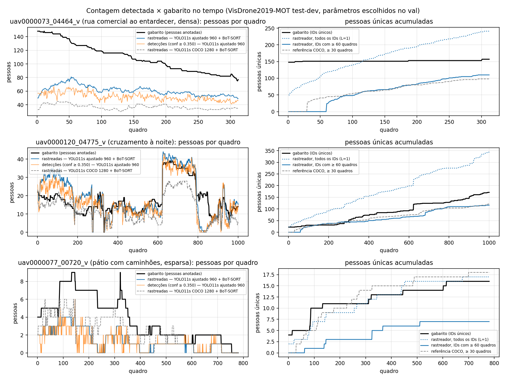

### 4.4 Pessoas únicas e a inflação por troca de ID

| Combinação (test-dev, 16 sequências com pessoas) | IDs brutos (L=1) | Erro do total (L=1) | IDs com ≥ L quadros | Erro do total (L do val) | Erro rel. abs. médio por seq. (L=1 / L do val) |
|---|---|---|---|---|---|
| gabarito | 1.012 pessoas | — | — | — | — |
| ajustado 960 + BoT-SORT (L=60) | 2.095 | +107 % | 584 | −42 % | 126 % / 51 % |
| ajustado 960 + ByteTrack (L=60) | 2.684 | +165 % | 500 | −51 % | 180 % / 63 % |
| COCO 1280 + BoT-SORT (L=30) | 1.173 | +16 % | 599 | −41 % | 53 % / 46 % |
| COCO 960 + BoT-SORT (L=10) | 880 | −13 % | 705 | −30 % | 36 % / 29 % |

**Contar IDs do rastreador não é contar pessoas.** Com o ajustado 960 + BoT-SORT, os 2.095 IDs brutos decompõem-se em
861 IDs falsos (trilhas curtas sobre falsos positivos, nunca casadas com uma pessoa) e 1.234 IDs casados com 816
pessoas distintas, isto é, 418 IDs **extras por troca de identidade ou fragmentação** (1,51 ID por pessoa rastreada);
196 pessoas nunca foram rastreadas. Portanto, a inflação líquida de +1.083 = 861 + 418 − 196. A fragmentação ocorre
quando a trilha se perde (oclusão por árvores, veículos e outras pessoas; detecção intermitente de pessoas pequenas;
saída e reentrada no campo de visão; movimento brusco de câmera) e, ao reaparecer após o `track_buffer`, a pessoa
recebe um ID novo; a troca ocorre em multidões, quando duas trajetórias próximas trocam de caixa. Com o ByteTrack
(sem GMC) os extras sobem para 818 (2,04 IDs por pessoa). O COCO 1280 gera menos IDs falsos (330) e menos extras
(206), mas perde 375 pessoas; os erros se compensam no total (+16 %), o que não significa contagem correta.

O filtro por comprimento mínimo (L) troca inflação por subcontagem: no test-dev, o L escolhido no val (60 quadros
para o ajustado) elimina os IDs falsos e fragmentos, mas também as pessoas vistas por pouco tempo, levando a −42 %.
A Figura v13 mostra que o L ótimo do test-dev (≈ 30 para o ajustado e 10–15 para o COCO) difere do escolhido no val
— com apenas 7 sequências no val, essa escolha é ruidosa —, e que nenhum L único dá erro baixo em todas as
sequências (melhor caso a posteriori: 23–28 % de erro médio por sequência). O melhor resultado *sem vazamento* para
pessoas únicas foi o do COCO 960 + BoT-SORT (L=10): 29 % de erro relativo absoluto médio e −30 % no total.

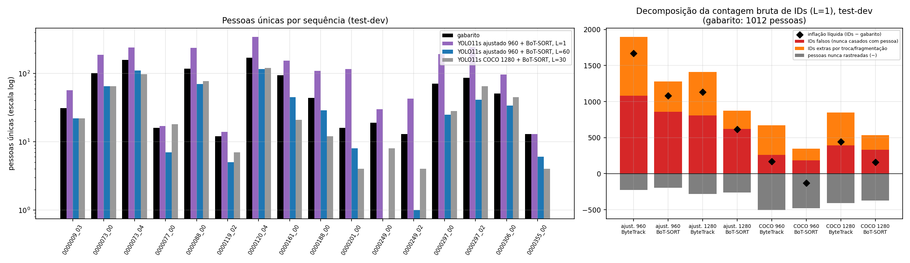

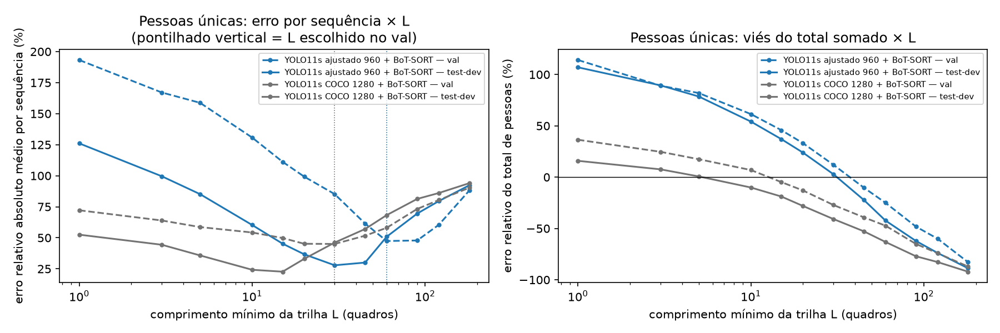

### 4.5 Resultados por sequência (ajustado 960 + BoT-SORT, test-dev)

| Sequência | Resol. | Pess./quadro | Altura mediana (px) | HOTA | MOTA | IDF1 | IDSW | MAE quadro (trilhas) | Únicas: gabarito / L=1 / L=60 |
|---|---|---|---|---|---|---|---|---|---|
| uav0000009_03358 | 1360×765 | 18,9 | 27 | 0,346 | 0,012 | 0,399 | 54 | 4,18 | 31 / 57 / 22 |
| uav0000073_00600 | 1920×1080 | 43,1 | 83 | 0,427 | 0,449 | 0,569 | 145 | 7,15 | 101 / 187 / 65 |
| uav0000073_04464 | 1920×1080 | 109,3 | 49 | 0,365 | 0,326 | 0,468 | 160 | 48,21 | 157 / 241 / 110 |
| uav0000077_00720 | 1360×765 | 3,8 | 42 | 0,254 | 0,299 | 0,416 | 8 | 2,43 | 16 / 17 / 7 |
| uav0000088_00290 | 960×540 | 72,9 | 36 | 0,319 | 0,326 | 0,410 | 190 | 26,50 | 117 / 237 / 70 |
| uav0000119_02301 (noite) | 1360×765 | 7,9 | 29 | 0,307 | 0,016 | 0,377 | 3 | 2,83 | 12 / 14 / 5 |
| uav0000120_04775 (noite) | 1360×765 | 18,0 | 40 | 0,330 | −0,018 | 0,427 | 148 | 5,71 | 171 / 345 / 116 |
| uav0000161_00000 | 960×540 | 46,6 | 24 | 0,234 | −0,058 | 0,257 | 89 | 20,94 | 94 / 155 / 45 |
| uav0000188_00000 | 960×540 | 20,5 | 16 | 0,186 | −0,763 | 0,075 | 2 | 3,39 | 44 / 109 / 29 |
| uav0000201_00000 | 1344×756 | 2,9 | 29 | 0,116 | −0,969 | 0,114 | 14 | 2,77 | 16 / 116 / 8 |
| uav0000249_00001 | 1920×1080 | 1,5 | 47 | 0,298 | −0,271 | 0,376 | 4 | 0,81 | 19 / 30 / 0 |
| uav0000249_02688 | 1344×756 | 1,1 | 31 | 0,251 | −1,316 | 0,323 | 1 | 1,80 | 13 / 43 / 1 |
| uav0000297_00000 | 1904×1071 | 24,3 | 91 | 0,336 | −0,147 | 0,440 | 44 | 8,44 | 71 / 192 / 25 |
| uav0000297_02761 | 1904×1071 | 25,9 | 108 | 0,323 | −0,170 | 0,384 | 77 | 4,54 | 86 / 243 / 41 |
| uav0000306_00230 | 680×382 | 10,4 | 19 | 0,272 | −0,680 | 0,260 | 30 | 3,75 | 51 / 96 / 34 |
| uav0000355_00001 | 1360×765 | 3,4 | 31 | 0,244 | 0,048 | 0,315 | 5 | 1,71 | 13 / 13 / 6 |
| uav0000370_00001 | 2720×1530 | 0,0 | — | — | — | — | 0 | 0,00 | 0 / 0 / 0 |

A tabela completa (val e test-dev, principal e referência, com MAPE, viés, contagem por detecções e decomposição)
está em `resultados/tabela_por_sequencia.csv`. MOTA negativo ocorre nas cenas esparsas, em que dezenas de falsos
positivos somados aos quadros superam o número de pessoas anotadas.

### 4.6 Análise por condição

Médias por sequência no test-dev (16 sequências com pessoas), ajustado 960 + BoT-SORT; entre parênteses, a referência
COCO 1280 + BoT-SORT:

| Condição (critério) | n | HOTA | IDF1 | MAPE por quadro |
|---|---|---|---|---|
| Escala pequena (altura mediana < 35 px) | 8 | 0,244 (0,214) | 0,265 (0,247) | 56,7 % (62,8 %) |
| Escala média (35–60 px) | 5 | 0,313 (0,318) | 0,419 (0,432) | 47,8 % (56,7 %) |
| Escala grande (> 60 px) | 3 | 0,362 (0,432) | 0,464 (0,563) | 24,0 % (21,3 %) |
| Densidade baixa (< 5 pessoas/quadro) | 5 | 0,232 (0,275) | 0,309 (0,374) | 82,5 % (65,4 %) |
| Densidade média (5–30) | 7 | 0,300 (0,287) | 0,337 (0,346) | 30,3 % (39,5 %) |
| Densidade alta (> 30) | 4 | 0,336 (0,303) | 0,426 (0,385) | 35,0 % (61,6 %) |
| Dia/entardecer (luminância ≥ 70) | 14 | 0,284 (0,287) | 0,343 (0,361) | 49,7 % (54,6 %) |
| Noite (luminância < 70) | 2 | 0,318 (0,288) | 0,402 (0,388) | 34,3 % (42,7 %) |
| Câmera em movimento (GMC > 0,25 % da largura/quadro) | 7 | 0,265 (0,255) | 0,328 (0,325) | 67,9 % (60,7 %) |
| Câmera quase parada | 9 | 0,306 (0,312) | 0,368 (0,395) | 32,1 % (47,3 %) |

A **escala da pessoa na imagem** (proxy de altitude e distância) é o fator mais associado ao desempenho: correlação
de Spearman entre altura mediana e HOTA de ρ = 0,62 (p = 0,011) para o ajustado e ρ = 0,87 (p < 0,001) para o COCO
(densidade: ρ = 0,51, p = 0,043, para o ajustado; ρ = 0,22, p = 0,41, para o COCO). A
análise de erros (Figura v14, `53_analise_erros.py`) quantifica isso: a revocação (IoU ≥ 0,5) do ajustado é de 12 %
para pessoas com menos de 20 px de altura (COCO: 2 %), 30 % entre 20 e 40 px (15 %), 56 % entre 40 e 80 px (43 %) e
66 % acima de 80 px (COCO: 75 %). **O ajuste no VisDrone-DET compensa justamente a faixa de pessoas pequenas**, que
é a de uma missão em nádir a 40 m; para pessoas grandes, o COCO localiza melhor. Dos 47.186 falsos positivos do
ajustado, 41 % sobrepõem uma pessoa com IoU ≥ 0,3 (localização imprecisa ou caixa duplicada, coerente com o LocA
menor e com diferenças de convenção de caixa entre as anotações DET e MOT), 15 % sobrepõem parcialmente e 44 % não
sobrepõem nenhuma pessoa anotada (objetos confundidos ou pessoas não anotadas). Cenas esparsas têm o pior HOTA e o
maior MAPE (cada falso positivo pesa muito), e as cenas densas, o maior erro absoluto. A noite não degradou o
desempenho nas duas sequências noturnas do test-dev (ruas iluminadas), mas n = 2 não permite conclusão; o movimento de
câmera piorou o MAPE, apesar da GMC. As correlações com luminância e movimento de câmera não foram significativas
(|ρ| ≤ 0,36, p ≥ 0,17).

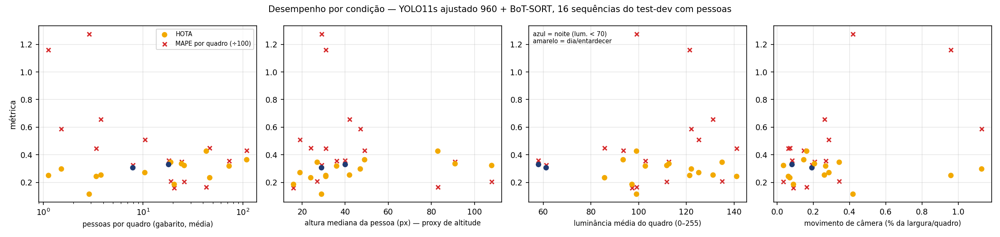

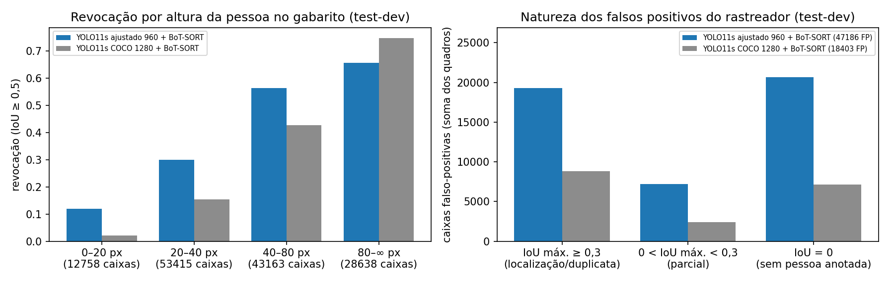

### 4.7 Vazão no GB10

| Vídeo | Combinação | Leitura JPEG (ms) | Detecção (ms) | Rastreador (ms) | Total (ms) | FPS ponta a ponta |
|---|---|---|---|---|---|---|
| 4K (3840×2160) | ajustado 960 + ByteTrack | 19,3 | 8,8 | 0,3 | 28,3 | 35,3 |
| 4K | ajustado 960 + BoT-SORT | 15,9 | 7,9 | 19,6 | 43,5 | 23,0 |
| 4K | ajustado 1280 + BoT-SORT | 15,9 | 13,9 | 24,1 | 53,9 | 18,5 |
| 4K | COCO 960 + ByteTrack | 15,9 | 7,9 | 0,2 | 23,9 | 41,8 |
| 1344×756 | ajustado 960 + ByteTrack | 2,8 | 7,2 | 1,5 | 11,6 | 86,4 |
| 1344×756 | ajustado 960 + BoT-SORT | 2,1 | 7,2 | 5,2 | 14,5 | 68,9 |
| 1344×756 | ajustado 1280 + BoT-SORT | 2,2 | 11,6 | 5,3 | 19,1 | 52,4 |
| 1344×756 | COCO 960 + BoT-SORT | 2,2 | 7,1 | 4,8 | 14,1 | 71,0 |

A detecção do YOLO11s em FP32 custa 7–9 ms por quadro a 960 px (114–146 FPS só de detecção) e 12–14 ms a 1280 px
(72–86 FPS), com o quadro já em memória. Esses valores são bem maiores que os 25,5 FPS medidos na etapa anterior
para o mesmo modelo (lote 1, imagens também em memória); a ocupação da GPU por outros jobs não foi controlada em
nenhuma das duas medições e a causa da diferença não foi isolada. Em
4K, o gargalo passa a ser a decodificação do JPEG (16–19 ms) e a GMC do BoT-SORT (≈ 19–24 ms, fluxo óptico sobre o
quadro reduzido a 1920×1080), que poderia ser calculada em resolução menor. Mesmo assim, todas as combinações rodam
acima de 18 FPS em 4K e acima de 52 FPS em 1344×756 com o Spark sob carga de 26–30, e a memória de GPU alocada pelo
PyTorch não passou de 0,33 GB em fluxo (1,0 GB com lote 8).

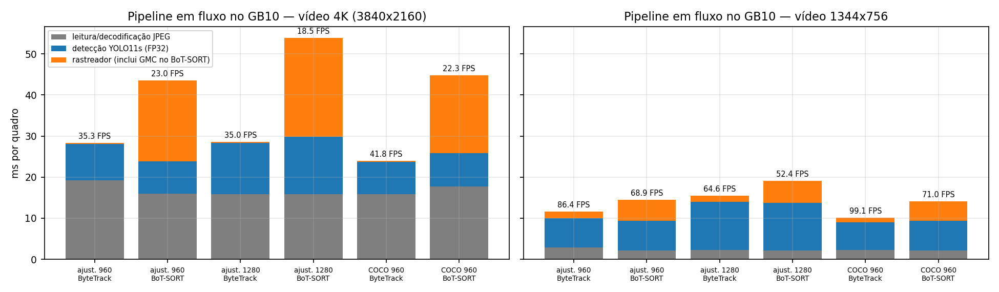

### 4.8 Evidências visuais

Os quadros abaixo mostram as trilhas (caixa colorida e ID), o gabarito (caixas brancas finas), as regiões ignoradas
(cinza) e, no cabeçalho, a contagem atual e a acumulada. Os vídeos `evidencias/v_video_uav0000073_04464_v.mp4`
(rua comercial densa, 312 quadros, 12,5 s, 7,9 MB) e `evidencias/v_video_uav0000120_04775_v.mp4` (cruzamento à
noite, 450 quadros, 18 s, 5,9 MB), em H.264 1280×720 a 25 quadros/s, trazem a mesma sobreposição ao longo do tempo.

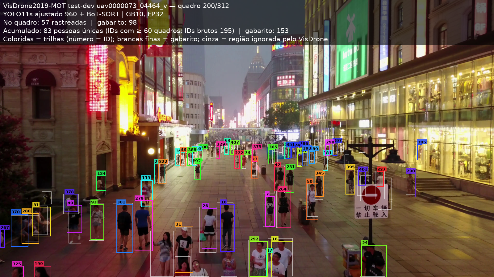

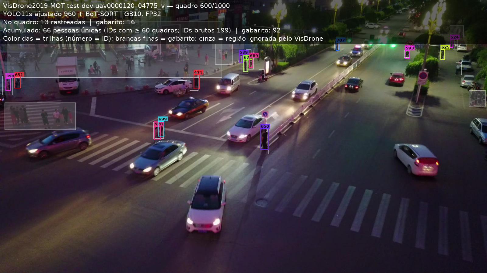

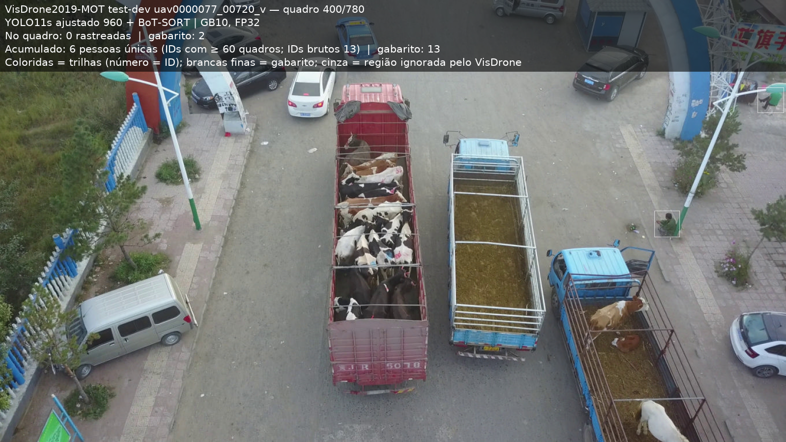

### 4.9 Prints de terminal

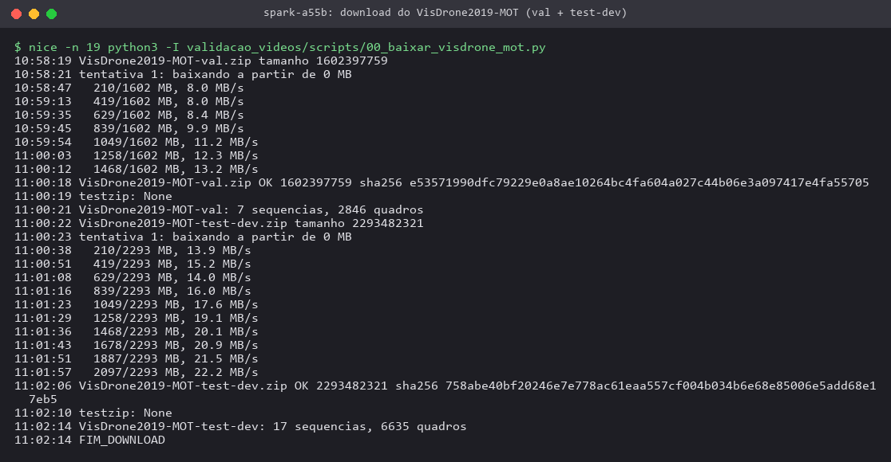

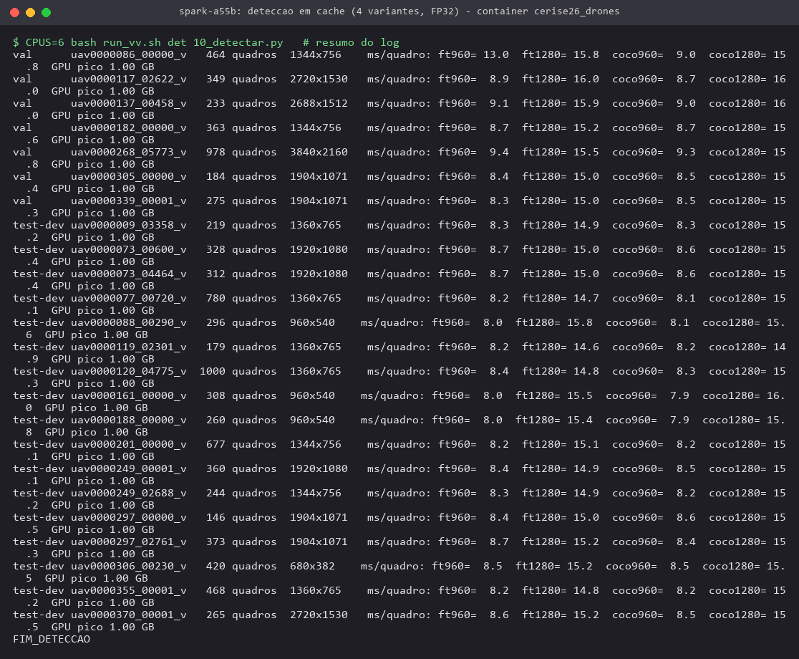

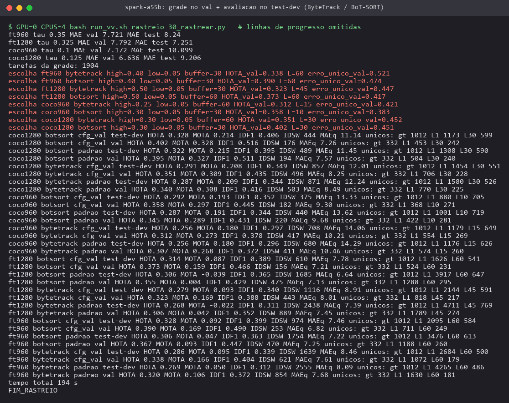

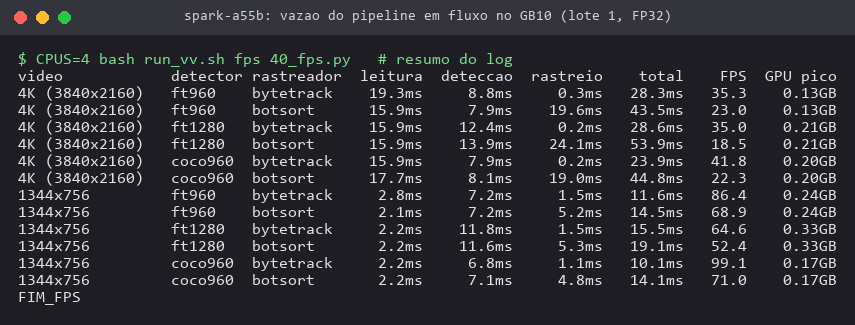

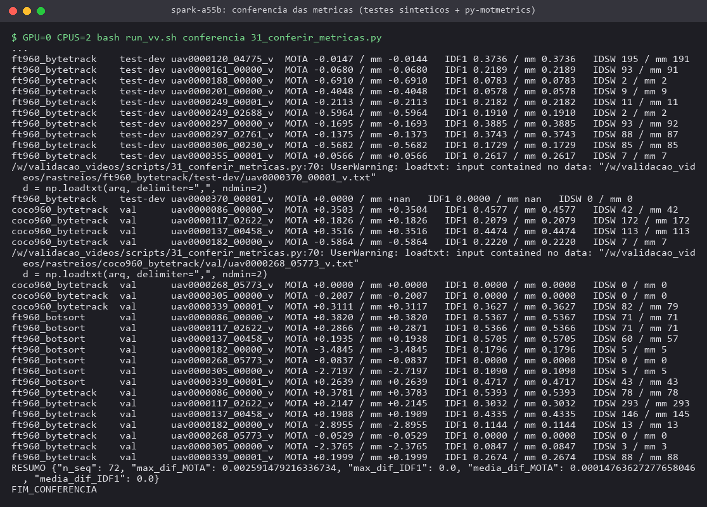

## 5. Discussão para a missão no Campus Samambaia

1. **Para a ocupação instantânea**, a contagem pelas trilhas ativas do detector ajustado com BoT-SORT (escolhida no
   val; MAE 7,46 pessoas/quadro e MAPE 51 % no test-dev) ou pelas detecções do ajustado a 1280 px (MAE 7,25) são as
   melhores opções medidas, mas subcontam em multidões e em pessoas abaixo de
   ~40 px. Na missão planejada (nádir, 40 m), uma pessoa vista de cima (~0,5 m) ocupa, por estimativa
   geométrica, ~17 px numa imagem de 1920 px e ~34 px numa de 3840 px com HFOV de 70° (faixa de ~56 m no solo);
   isso coloca a operação na faixa em que o ajuste no VisDrone mais ajuda e em que a revocação medida ainda é
   baixa (12–30 % abaixo de 40 px).
2. **Para o número de pessoas distintas**, os IDs do rastreador não servem como contador direto: inflam 2× (IDs
   falsos e fragmentação) ou, filtrados por duração, subcontam ~40 %. Na missão em varredura (*boustrophedon*), cada
   pessoa fica pouco tempo no campo de visão e reaparece na faixa adjacente, o que favorece a **deduplicação
   geográfica** já implementada (`cerise_drones.agregacao`) sobre a deduplicação por ID: a posição no solo, e não o
   ID, deve ser a chave. Os IDs servem para agregar detecções de uma mesma passagem antes da projeção.
3. **BoT-SORT com GMC é obrigatório em vídeo de drone**: a GMC respondeu sozinha por +0,03 a +0,04 de HOTA e −39 a
   −44 % de trocas de ID no test-dev. O custo (≈ 5 ms em 1344×756, ≈ 20 ms em 4K) cabe no orçamento de tempo do GB10.

## 6. Limitações

- O VisDrone2019-MOT é majoritariamente **oblíquo e urbano (China)**, com câmera a baixa altura; a missão da UFG é
  em nádir sobre um campus. Os números indicam tendências (escala, densidade, câmera), não o erro esperado na UFG.
- O gabarito do VisDrone-MOT tem regiões ignoradas extensas e pessoas não anotadas; parte dos 44 % de falsos
  positivos "sem pessoa anotada" pode ser de pessoas reais, e o desacordo de convenção de caixas entre VisDrone-DET
  (treino) e VisDrone-MOT (teste) reduz o LocA e a precisão a IoU 0,5.
- O val tem só 7 sequências (2 delas com 6 pessoas), o que torna ruidosa a escolha de L e dos limiares; a Figura
  v13 mostra a diferença entre o L escolhido e o L ótimo *a posteriori* do test-dev, que não foi usado.
- Apenas 2 sequências noturnas no test-dev; a conclusão sobre iluminação é inconclusiva. A altitude real não é
  anotada; usou-se a altura da pessoa em pixels como proxy.
- Os tempos foram medidos com o Spark compartilhado (carga 26–33 em 20 núcleos); são limites inferiores de vazão.
- O ReID do BoT-SORT não foi avaliado, porque exigiria as *features* do detector, que não ficaram em cache.
- O TrackEval original não foi executado; HOTA/MOTA/IDF1 vêm da reimplementação conferida contra o py-motmetrics
  (MOTA e IDF1) e por casos analíticos (HOTA, incluindo AssA).

## 7. Próximos passos

1. Ajustar o detector também no VisDrone-MOT train (56 sequências) e testar 1280 px no treino, visando a faixa de
   20–40 px, com avaliação de novo neste protocolo.
2. Avaliar BoT-SORT com ReID (*features* nativas do YOLO) e a contagem de únicos com associação de trilhas
   fragmentadas (re-identificação offline por aparência e tempo).
3. Integrar trilhas + georreferenciamento: projetar cada trilha no solo com a pose do drone e deduplicar por posição,
   validando com os voos simulados (Isaac Sim / Gazebo+PX4) e, depois, com vídeo próprio do Campus Samambaia anotado.
4. Reduzir a GMC para 960 px e usar decodificação de vídeo por hardware (NVDEC) para o fluxo 4K.

## Arquivos de resultados

`resultados/selecao_val.json` (grade e escolhas), `grade_val.csv`, `metricas_agregadas.json`,
`metricas_por_sequencia.json`, `tabela_por_sequencia.csv`, `contagem_deteccoes.json`, `condicoes_sequencias.json`,
`condicoes_analise.json`, `analise_erros.json`, `ablacao_gmc.json`, `erro_unico_vs_L.json`, `fps_gb10.json`,
`log_deteccao.json`, `conferencia_metricas.json`.
